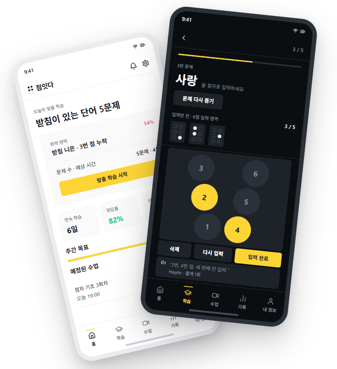
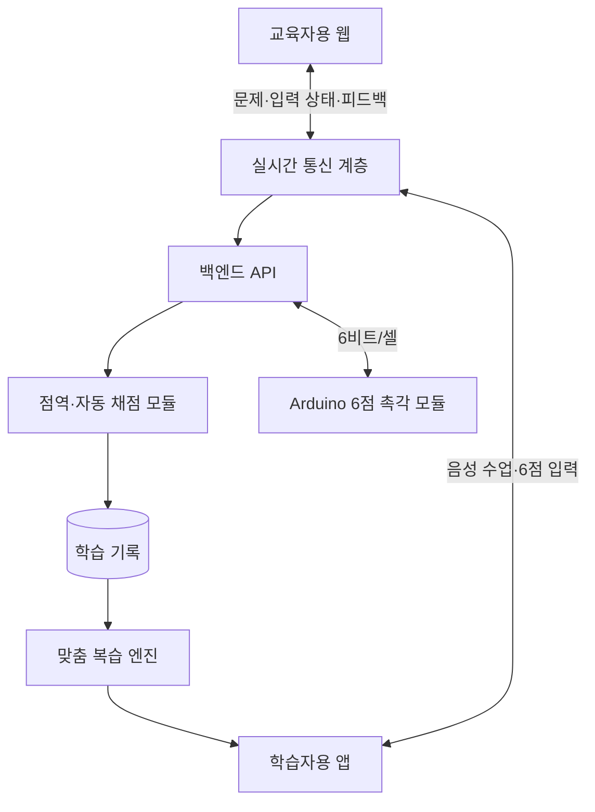

# 이음 (I:EUM)

> 교육자와 학습자, 디지털 입력과 촉각 경험을 이어 주는 시각장애인 점자 학습 플랫폼

<p align="center">
  
</p>

이음은 점자를 처음 배우거나 꾸준한 반복 연습이 필요한 학습자를 위한 **실시간 점자 수업 및 개인 맞춤 복습 서비스**입니다. 교육자의 온라인 수업, 스마트폰 6점 입력, 세부 오답 분석, 맞춤형 복습, 저비용 촉각 출력을 하나의 학습 과정으로 연결합니다.

## 프로젝트 소개

점자는 시각장애인이 문자 정보를 직접 읽고 쓰며 지식에 접근하기 위한 핵심 문자 체계입니다. 음성 기술이 발전해도 철자, 숫자, 기호, 문장 구조를 정확히 이해하고 스스로 기록하려면 점자 문해력이 필요합니다.

하지만 점자 학습 현장에는 다음과 같은 어려움이 있습니다.

- 학습자마다 자주 혼동하는 점 위치와 문자 규칙이 달라 개별 피드백이 필요합니다.
- 수업 시간과 전문 인력이 제한되어 충분한 반복 연습을 제공하기 어렵습니다.
- 모바일 학습만으로는 실제 돌출점을 손끝으로 읽는 촉지 경험을 제공하기 어렵습니다.
- 전용 점자 단말기와 디스플레이는 기초 학습용으로 사용하기에 가격 부담이 큽니다.

이음은 **배울 기회 → 반복 연습 → 피드백 → 촉각 확인**을 하나의 플랫폼 안에서 제공합니다.

## 학습 흐름


## 주요 기능

| 기능 | 설명 |
| --- | --- |
| 실시간 온라인 수업 | 교육자가 문제를 출제하고 학습자의 입력 상태와 채점 결과를 실시간으로 확인합니다. |
| 접근성 중심 6점 입력 | 학습자는 스마트폰의 6개 점 영역을 이용해 답을 입력하고 TTS·햅틱으로 안내받습니다. |
| 세부 오답 분석 | 단순 정오 판정을 넘어 빠뜨린 점, 잘못 추가한 점, 반복해서 혼동하는 규칙을 분석합니다. |
| 개인 맞춤 복습 | 정답률, 풀이 시간, 최근 오답, 반복 빈도를 바탕으로 복습 우선순위를 조정합니다. |
| 촉각 학습 연동 | 점자 패턴을 Arduino 기반 6점 출력 모듈에 전달해 실제 돌출점으로 확인합니다. |
| 학습 기록 관리 | 수업 참여, 출제 문제, 입력값, 오답 유형, 복습 이력을 누적해 학습자와 교육자에게 제공합니다. |

## 핵심 기술

### 1. 전 구간을 잇는 6비트 점자 표현

하나의 점자 셀은 1번부터 6번까지 각 점의 ON/OFF 상태를 나타내는 **6비트 정수**로 표현합니다. 입력 UI, 자동 채점, 학습 기록, BLE 촉각 모듈이 같은 표현을 사용하므로 별도의 변환 과정 없이 데이터를 전달할 수 있습니다.

- 점 `n`의 위치: `1 << (n - 1)`
- 점자 셀 범위: Unicode `U+2800` ~ `U+283F`
- BLE 전송 단위: 점자 셀당 1바이트
- 예시: `⠧` = `0x27` = 1·2·3·6번 점

```python
def cell_to_dots(ch):
    value = ord(ch) - 0x2800
    return [i + 1 for i in range(6) if (value >> i) & 1]


def dots_to_cell(dots):
    value = sum(1 << (dot - 1) for dot in dots)
    return chr(0x2800 + value)
```

### 2. 비트 연산 기반 자동 채점

정답과 학습자 입력을 정수로 비교하고 XOR 연산으로 서로 다른 점을 찾습니다. 이를 바탕으로 학습자가 빠뜨린 점과 잘못 추가한 점을 분리하여 구체적인 피드백을 제공합니다.

```python
diff = expected ^ actual
missing = expected & (~actual & 0x3F)
extra = actual & (~expected & 0x3F)
```

예를 들어 정답이 1·3·5번 점이고 학습자가 1·5번 점만 입력했다면, 결과를 단순한 오답이 아니라 **3번 점 누락**으로 기록합니다.

### 3. 개인 맞춤 복습

모든 풀이 기록을 Attempt 단위로 저장하고, 학습자의 취약 유형과 기억 강도를 바탕으로 오늘의 복습 세션을 구성합니다.

| 전략 | 역할 |
| --- | --- |
| Leitner SRS | 학습 로그가 적을 때도 안정적으로 동작하는 반복 복습 안전망 |
| HLR | 정답 여부와 경과 시간을 이용해 기억의 반감기를 추정하고 복습 시점을 조정 |
| BKT | 자음·모음·받침·약자·문장부호 등 카테고리별 숙련도를 추정 |

문제 생성이 필요한 경우 학습자의 취약 프로필을 바탕으로 후보 문제를 만들고, 규칙 기반 검증 모듈이 목표 점 번호와 점자 규칙의 포함 여부를 다시 확인합니다.

## 데이터셋과 문제 은행

문제 은행과 점역 엔진의 기준 데이터로 **국립국어원 묵자-점자 병렬 말뭉치 2025**를 사용합니다.

- 신문 기사 83,528 문장쌍, 약 167만 어절
- `source` 한글 문장과 `target` 점자 문장으로 구성
- 전체 문장에 검수본 `revision.revision1` 포함
- 「한국 점자 규정」(2024)을 적용한 순수 6점 유니코드 점자
- 한글 약 100자당 평균 151개의 점자 셀

### 문제 은행 v0

어절 수가 일치하는 61,587개 문장에서 한글 어절과 점자 어절을 정렬하고, 단어별 점역 결과의 다수결과 빈도 필터를 적용해 **24,430개 단어 문제**를 추출했습니다.

| 레벨 | 기준 | 문항 수 |
| :---: | --- | ---: |
| L1 | 받침 없는 2자 이하 단어 | 773 |
| L2 | 받침이 있는 2자 이하 단어 | 1,171 |
| L3 | 약자·약어가 포함된 단어 | 18,650 |
| L4 | 3자 이상의 긴 단어 | 3,836 |
| **합계** |  | **24,430** |

추출 과정에서는 단어별 점역 일치율이 90% 미만인 항목을 제외하고, 빈도 5회 이상인 단어만 채택했습니다. 모든 항목은 점자 셀과 유니코드 간 라운드트립, 점 번호 범위, 길이 정합성을 확인했습니다.

<details>
<summary>데이터 가공 시 고려사항</summary>

- 신문 기사 기반 말뭉치이므로 초급 생활 어휘의 비중이 낮습니다.
- 약자 검출은 실제 점자 셀 수와 자모별 예상 셀 수를 비교하는 휴리스틱을 사용합니다.
- 자모, 받침, 점 위치를 익히는 기초 문제는 점자 규칙 기반 생성이 함께 필요합니다.

</details>

## 시스템 구성



- **학습자용 앱**: 수업 참여, TTS 안내, 6점 입력, 햅틱 피드백, 맞춤 복습
- **교육자용 웹**: 수업방 관리, 문제 출제, 학습자별 입력·오답 확인, 학습 리포트
- **실시간 통신**: WebRTC 기반 음성 수업과 WebSocket 기반 입력 상태 전달
- **백엔드**: 사용자·수업·문제·입력값·오답·복습 이력 관리
- **학습 엔진**: 한글 점역, 규칙 기반 채점과 피드백, 복습 세션 구성
- **IoT 모듈**: 6비트 점자 패턴을 실제 6점 돌출 상태로 출력

## 학습 엔진 인터페이스

| 인터페이스 | 역할 |
| --- | --- |
| `grade` | 정답과 입력 점자 셀을 비교하고 누락점·추가점을 계산 |
| `getFeedback` | 오답 유형을 학습자가 이해할 수 있는 안내로 변환 |
| `buildTodaySession` | 취약도와 복습 시점을 반영해 오늘의 학습 세션 구성 |
| `updateReviewState` | 풀이 결과를 바탕으로 개인별 복습 상태 갱신 |

## 주요 사용자

- 점자를 처음 배우는 중도 시각장애인
- 학교 수업 외에 반복 학습이 필요한 시각장애 학생
- 점자 학습자를 지도하는 맹학교·특수학교 교사
- 시각장애인 복지관과 점자교육원 등 교육기관

## 팀 소개

- **팀명**: 점심시간
- **프로젝트**: SSAFY 2학기 특화 프로젝트 B201
- **인원**: 6명

| 최현철 | 박호진 | 정재현 | 채승규 | 윤성빈 | 김민재 |
| :---: | :---: | :---: | :---: | :---: | :---: |
| PM, BE | AI | FE, Infra | FE, BE | BE, IoT | BE |
|  |  |  |  |  |  |
| [GitHub](https://github.com/HyunCheol1211) | [GitHub](https://github.com/hohojinjin) | [GitHub](https://github.com/pastjung) | [GitHub](https://github.com/csk6314) | [GitHub](https://github.com/dbstjdqls14) | [GitHub](https://github.com/minjaekim1122) |

## 데이터 출처

> 국립국어원(2025). *국립국어원 묵자-점자 병렬 말뭉치 2025* (버전 1.0). 2026-06-30 공개. [국립국어원 모두의 말뭉치](https://kli.korean.go.kr/corpus)
