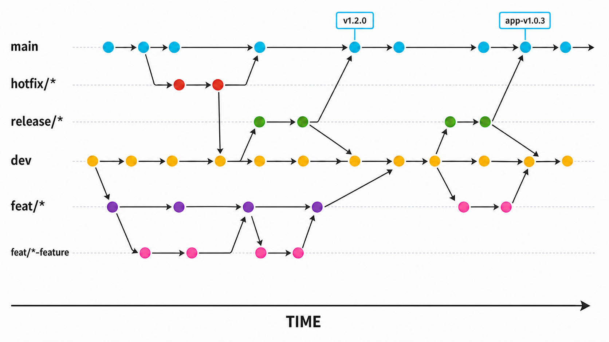

# Git 브랜치 전략

## 1. 목적

이 문서는 GitLab Issue, Merge Request, 서버 릴리스, 모바일 릴리스를 일관된 방식으로 관리하기 위한 브랜치 규칙을 정의한다.

이 프로젝트는 `main`과 `dev`를 장기 브랜치로 사용하는 경량 Git Flow를 적용한다. 서버와 모바일은 같은 저장소를 사용하지만 서로 다른 버전과 태그로 배포한다.

## 2. 장기 브랜치

| 브랜치 | 역할 | 직접 push |
| --- | --- | :---: |
| `main` | 검증이 끝난 릴리스 이력 | 금지 |
| `dev` | 다음 릴리스를 위한 통합 개발 | 금지 |

- 모든 변경은 Merge Request로 병합한다.
- force push를 허용하지 않는다.
- `main`은 GitLab 기본 브랜치로 사용한다.
- 실제 운영 버전은 `main`의 최신 커밋이 아니라 서버 또는 모바일 태그로 식별한다.

### 브랜치 흐름 개요



시간은 왼쪽에서 오른쪽으로 흐른다. 청록색은 `main`, 빨간색은 `hotfix/*`, 초록색은 `release/*`, 노란색은 `dev`, 보라색은 상위 `feat/*`, 분홍색은 하위 또는 단일 기능 브랜치를 나타낸다. 화살표는 브랜치가 시작되거나 MR로 병합되는 방향을 의미한다.

## 3. 브랜치 이름 형식

일반 작업 브랜치는 다음 형식을 사용한다.

```text
<type>/[<issue-number>-]<domain>[-<feature>]
```

작성 규칙은 다음과 같다.

- 영문 소문자, 숫자, 하이픈만 사용한다.
- 이슈 번호는 선택 사항이다.
- 이슈와 연결된 작업은 `<issue-number>-`를 도메인 앞에 붙인다.
- `domain`에는 `user`, `lesson`, `review` 같은 비즈니스 도메인을 사용한다.
- `feature`에는 `login`, `ui`, `history-search`처럼 작업 목적을 사용한다.
- 브랜치명만 보고 작업 목적을 이해할 수 있어야 한다.

```text
# 이슈가 있는 작업
feat/456-user-login
fix/457-lesson-empty-list

# 이슈가 없는 작업
feat/user-login
fix/lesson-empty-list
```

## 4. 브랜치 종류

| 형식 | 용도 | 시작 브랜치 | 병합 대상 |
| --- | --- | --- | --- |
| `feat/<domain>`, `feat/<issue>-<domain>` | 여러 하위 작업을 모으는 통합 기능 | `dev` | `dev` |
| `feat/<domain>-<feature>`, `feat/<issue>-<domain>-<feature>` | 개별 기능 개발 | 상위 기능 또는 `dev` | 상위 기능 또는 `dev` |
| `fix/<domain>-<feature>`, `fix/<issue>-<domain>-<feature>` | 개발·릴리스 중 발견한 버그 수정 | 수정 대상 브랜치 | 수정 대상 브랜치 |
| `hotfix/<domain>-<feature>`, `hotfix/<issue>-<domain>-<feature>` | 운영 장애의 긴급 수정 | `main` | `main`, `dev` |
| `chore/<domain>-<feature>`, `chore/<issue>-<domain>-<feature>` | 설정, 문서, 저장소 유지보수 | `dev` | `dev` |
| `release/v<major>.<minor>.<patch>` | 서버 릴리스 안정화 | `dev` | `main`, `dev` |
| `release/app-v<major>.<minor>.<patch>` | 모바일 릴리스 안정화 | `dev` | `main`, `dev` |

버전에는 web과 app을 분리해서 사용한다.

```text
# web
release/v1.2.0

# app
release/app-v1.0.3
```

## 5. 기능 개발 흐름

### 복수 이슈를 포함하는 큰 기능

큰 기능은 상위 통합 브랜치와 하위 작업 브랜치로 나눈다. GitLab Issue를 사용하는 작업은 상위 기능과 하위 작업에 각각 별도 이슈를 연결하며, 하나의 이슈 번호를 여러 작업 브랜치에서 재사용하지 않는다.

```text
dev
└─ feat/450-user
   ├─ feat/456-user-login
   └─ feat/457-user-ui
```

1. `dev`에서 `feat/450-user`를 생성한다.
2. 상위 브랜치에서 각 하위 작업 브랜치를 생성한다.
3. 하위 작업은 `feat/450-user`를 대상으로 MR을 생성한다.
4. MR 리뷰와 검증이 끝나면 하위 브랜치를 병합하고 즉시 삭제한다.
5. 모든 하위 작업이 완료되면 `feat/450-user`를 `dev`로 병합한다.
6. 상위 브랜치도 병합 직후 삭제한다.

하위 작업 MR은 squash하여 작업당 하나의 의미 있는 커밋을 남긴다. 여러 하위 작업의 커밋을 보존하기 위해 상위 브랜치를 `dev`에 병합할 때는 다시 squash하지 않는다.

이슈를 생성하지 않은 작업도 동일한 흐름을 사용한다.

```text
dev
└─ feat/user
   ├─ feat/user-login
   └─ feat/user-ui
```

### 단일 기능

작업 규모가 작고 하위 작업을 나눌 필요가 없다면 상위 통합 브랜치를 생략한다.

```text
dev
└─ feat/458-lesson-search
```

작업 완료 후 `dev`를 대상으로 MR을 만들고 squash merge한 뒤 소스 브랜치를 삭제한다.

### 개발 중 기준 브랜치 동기화

- 개인만 사용하는 작업 브랜치는 `dev` 또는 상위 브랜치 위로 rebase할 수 있다.
- 여러 사람이 공유하는 상위 기능 브랜치에서는 force push와 rebase를 사용하지 않는다.
- 공유 브랜치를 최신화해야 한다면 `dev`를 상위 기능 브랜치에 merge한다.

## 6. 서버 릴리스 흐름

```text
dev
  └─ release/v1.2.0
        ├─ fix/460-user-login-timeout
        ├─ MR → main
        ├─ tag: v1.2.0
        └─ MR → dev
```

1. 릴리스 범위가 확정되면 `dev`에서 `release/v1.2.0`을 생성한다.
2. 릴리스 브랜치에서는 신규 기능을 추가하지 않는다.
3. 발견된 문제는 `fix/*` 브랜치에서 수정한 뒤 MR로 반영한다.
4. 검증이 끝나면 `main`에 병합한다.
5. 병합된 커밋에 `v1.2.0` 태그를 생성한다.
6. 릴리스 수정 사항을 `dev`에도 병합한다.
7. 릴리스 브랜치를 삭제한다.

## 7. 모바일 릴리스 흐름

모바일은 One Store 배포 주기가 서버와 다르므로 별도 버전을 사용한다.

```text
dev
  └─ release/app-v1.0.3
        ├─ MR → main
        ├─ tag: app-v1.0.3
        └─ MR → dev
```

- 모바일 버전과 관련된 안정화만 수행한다.
- 서버 배포 태그인 `v*`와 모바일 태그인 `app-v*`를 혼용하지 않는다.
- 모바일 릴리스가 `main`에 병합되어도 서버는 `v*` 태그가 생성되기 전까지 배포하지 않는다.
- `main`과 `dev`에 모두 병합한 뒤 릴리스 브랜치를 즉시 삭제한다.

## 8. 긴급 수정 흐름

운영 장애는 `main`에서 `hotfix/*`를 생성한다.

```text
main
  └─ hotfix/461-user-token-expiry
        ├─ MR → main
        ├─ tag: v1.2.1
        └─ MR → dev
```

긴급 수정도 `main`에 직접 push하지 않는다. MR 검증 후 patch 버전 태그를 생성하고 동일 변경을 `dev`에 반영한다.

## 9. 보호 및 병합 규칙

| 대상 | Allowed to merge | Allowed to push and merge | Force push |
| --- | --- | --- | :---: |
| `main` | Maintainers | No one | 사용하지 않음 |
| `dev` | Developers + Maintainers | No one | 사용하지 않음 |
| `release/*` | Maintainers | No one | 사용하지 않음 |

현재 GitLab 환경에서는 Merge Request Approvals 기능을 제공하지 않으므로 승인 인원을 시스템으로 강제하지 않는다. 리뷰어가 변경 사항을 확인하고 모든 리뷰 스레드를 해결한 후 병합한다. 세부 GitLab 설정은 [GitLab 프로젝트 설정](./gitlab-settings.md)을 따른다.

MR 병합 전 다음 조건을 확인한다.

- 이슈 기반 작업이면 관련 이슈가 연결되어 있다.
- 테스트 또는 파이프라인이 성공했다.
- 리뷰어가 변경 사항을 확인했고 미해결 스레드가 없다.
- 충돌이 해결되었다.
- 필요한 문서와 테스트가 변경 사항에 포함되어 있다.
- `Delete source branch`가 선택되어 있다.
