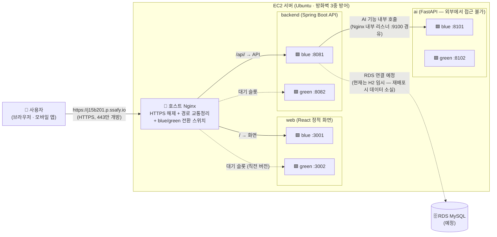
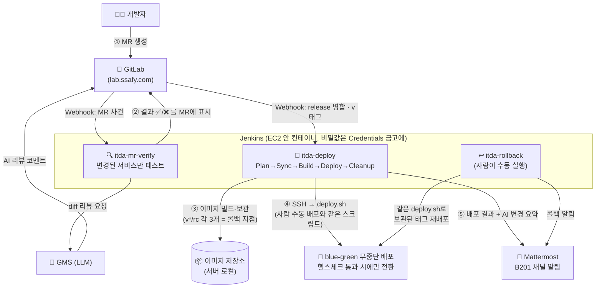

# 아키텍처

두 장으로 보는 전체 시스템. **사용자 아키텍처**는 "사용자의 요청이 어떻게 처리되는가", **시스템 아키텍처**는 "우리 코드가 어떻게 서버까지 가는가"를 그린다. (GitLab이 아래 Mermaid 블록을 다이어그램으로 렌더링한다)

## 1. 사용자 아키텍처 — 요청 하나의 여정

- **실선 = 지금 트래픽이 흐르는 길**, 점선 = 대기 슬롯/예정. 서비스마다 슬롯이 2개씩 있고 Nginx가 한쪽으로만 트래픽을 보낸다 — 배포는 빈 슬롯에 새 버전을 띄우고 스위치만 돌리는 방식이라 무중단이다 ([deploy.md](./deploy.md) 7절).
- 외부에서 접근 가능한 문은 사실상 호스트 Nginx(443) 하나다. 컨테이너 포트는 전부 127.0.0.1 바인딩이고, ai는 backend만 내부 리스너(9100)로 호출한다 ([deploy.md](./deploy.md) 3절).

## 2. 시스템 아키텍처 — 코드가 서버에 도착하기까지 (CI/CD)

- **dev/main 병합은 배포로 이어지지 않는다** — 서버로 가는 길은 release 병합과 v* 태그뿐 ([pipeline.md](./pipeline.md) 5절).
- 사람이 하는 일은 ①(MR)과 릴리스 담당의 클릭(release 생성·태그·롤백)뿐, ②~⑤는 자동.
- 배포와 롤백이 **같은 deploy.sh**를 쓰는 것이 핵심 설계 — 자동/수동/롤백이 다르게 동작하는 사고가 구조적으로 불가능하다.
