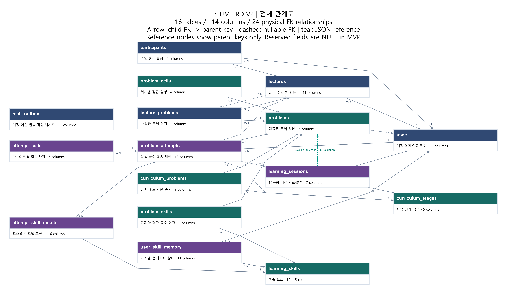
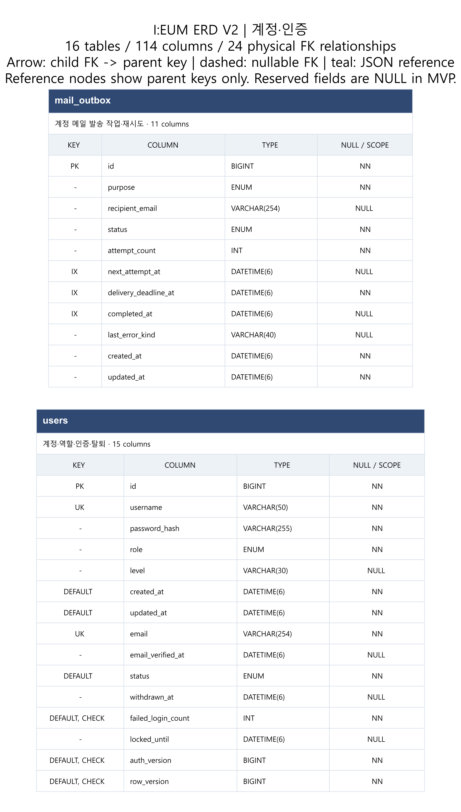
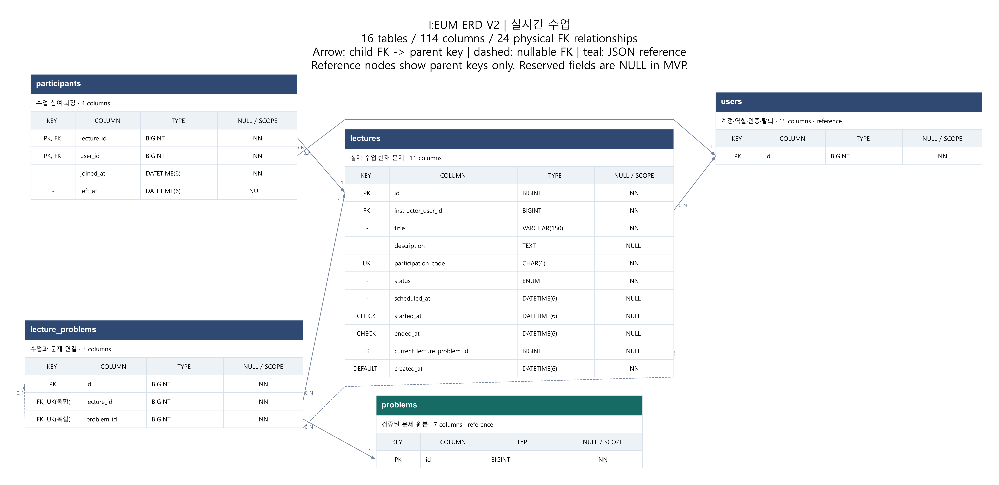
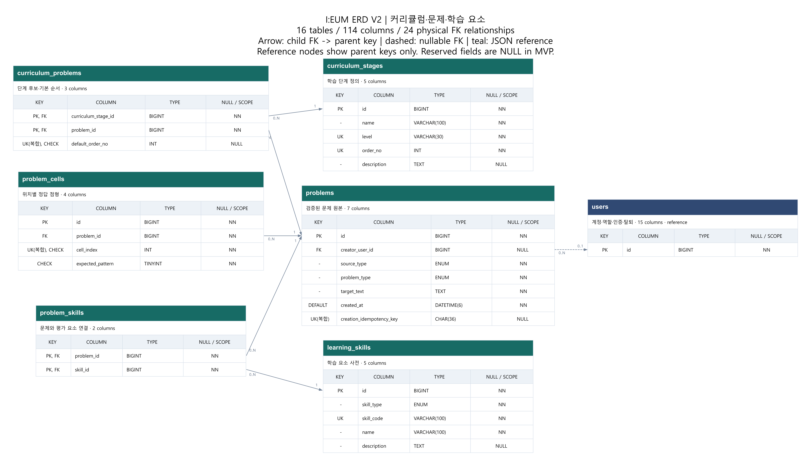
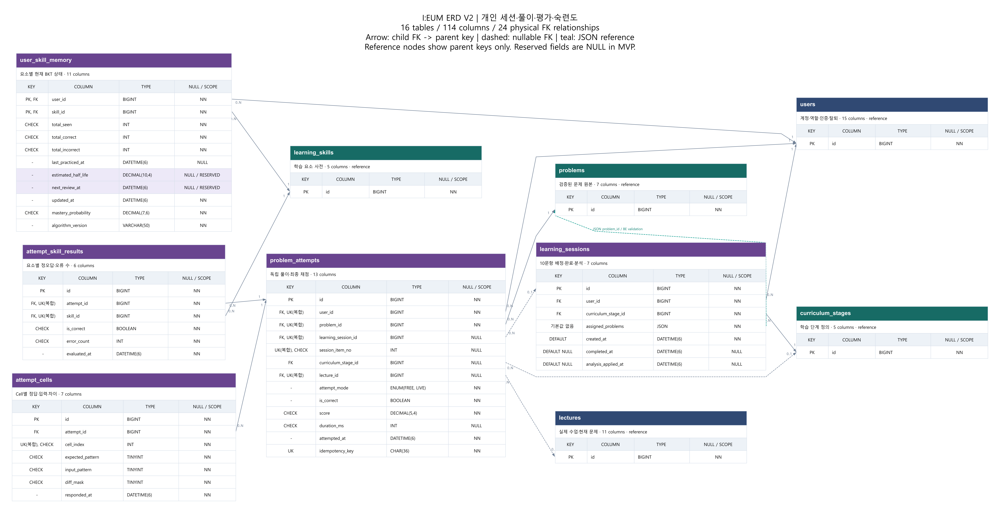

# I:EUM ERD V2

> 작성일: 2026-09-07 / 갱신일: 2026-09-09  
> 상태: 현행 MVP 기준 · 외부 연동·운영 세부는 후속 계약
> 근거: 원본 ERD 이미지의 하단 영역과 설계 결정 기록. 두 자료는 로컬 별도 참고 자료로 보관하며, 현행 도식은 이 문서에 첨부한다.

## 1. 문서 범위와 표기

이 문서는 16개 영속 테이블·114개 컬럼의 저장 목적과 관계·제약을 정의한다. 전체 관계도와 영역별 상세도는 아래 컬럼 표에서 생성하므로 테이블 이름·컬럼·키·NULL 허용 여부가 본문과 일치한다. 관계의 조건부 필수 여부와 업무 검증은 각 테이블 설명을 함께 읽는다.

- PK는 기본 키, FK는 외래 키, UK는 고유 제약, NN은 NOT NULL이다.
- 그림의 실선·점선 화살표는 자식 FK에서 부모 키로 향한다. 점선은 NULL 가능한 FK이며 양쪽 관계 수를 표시한다. 복합 고유 제약의 묶음은 본문의 제약 설명을 따른다.
- 청록 점선은 DB FK로 강제할 수 없는 배정 JSON의 문제 참조다. 백엔드가 문제 존재·단계 소속·순번 일치를 검증한다.
- 컬럼 표의 ‘용도’는 MVP 사용과 확장 예약을 구분한다. 변경 이력은 확정 기록(로컬 별도 참고 자료)에 보관한다.
- 물리 공통 기준은 7절, 실제 구현에서 확인할 계약은 8절을 따른다.

## 2. 전체 관계도와 테이블 지도

> 도식 범위: 최종 16개 영속 테이블·114개 컬럼·물리 FK 24개와 배정 JSON 참조 1개를 반영했다.



[전체 관계도 SVG](./images/erd-overview.svg) · 관계도 생성 스크립트는 로컬 작업 도구로 별도 보관한다.

### 전체 컬럼 통합 이미지

아래 이미지는 16개 테이블의 114개 컬럼과 관계를 한 장에 모두 표시한다. 컬럼명·타입·키·NULL 허용 여부를 확인할 때는 원본 PNG를 확대하거나 SVG를 연다. 데이터 설계는 본문과 동일하며, 기존 영역별 상세도도 유지한다.


[전체 상세도 PNG](./images/erd-full.png) · [확대용 전체 상세도 SVG](./images/erd-full.svg)

전체도는 관계 중심으로, 상세도는 각 영역의 전체 컬럼을 보여 준다. 같은 테이블이 여러 상세도에 등장해도 실제 테이블을 중복 생성하는 뜻은 아니다. 상세도의 RESERVED는 MVP에서 NULL로 유지하는 확장 예약 값이다. reference로 표시한 외부 테이블은 관계 확인용 PK만 표시하며 전체 컬럼은 소속 영역 상세도에서 확인한다.

| 영역 | 테이블 | 역할 |
| --- | --- | --- |
| 계정 | `users` | 로그인·단일 역할·인증·로그인 제한·탈퇴 상태 |
| 계정 메일 | `mail_outbox` | 이메일 인증·비밀번호 재설정 메일 발송 작업 |
| 실제 수업 | `lectures` | 한 번의 수업과 진행 상태 |
| 수업 참여 | `participants` | 수업·사용자의 참여 관계 |
| 수업 문제 | `lecture_problems` | 수업·문제 연결 |
| 커리큘럼 | `curriculum_stages` | 커리큘럼 단계 정의 |
| 단계 문제 | `curriculum_problems` | 단계·문제 연결 |
| 문제 원본 | `problems` | 검증 통과 문제 |
| 정답 Cell | `problem_cells` | 문제별 순서 있는 정답 점형 |
| 학습 요소 | `learning_skills` | 자모·규칙·점 요소 사전 |
| 문제 요소 | `problem_skills` | 문제·학습 요소 연결 |
| 개인 학습 세션 | `learning_sessions` | 한 번의 학습·복습의 배정 목록·완료·분석 반영 관리 |
| 풀이 | `problem_attempts` | 사용자별 실제 제출·최종 결과 |
| Cell 평가 | `attempt_cells` | 제출의 Cell별 정답·입력 비교 |
| 요소 평가 | `attempt_skill_results` | 제출의 학습 요소별 평가 |
| 현재 학습 상태 | `user_skill_memory` | 사용자·요소별 집계·현재 BKT 상태 |

## 3. 계정·수업 영역



[계정·인증 SVG](./images/erd-accounts.svg)

<a id="table-users"></a>
### 3.1 `users`

사용자 계정을 정의한다. 한 계정은 `LEARNER`, `INSTRUCTOR`, `ADMIN` 중 하나의 역할만 가진다. 이메일 인증·재발송·비밀번호 복구와 탈퇴 기능은 포함한다. 접근성 설정은 프론트엔드 로컬 저장이며 이 테이블에 추가하지 않는다.

| 컬럼 | 타입 | NULL | 키 | 용도 | 저장 내용·역할 |
| --- | --- | --- | --- | --- | --- |
| `id` | BIGINT | NN | PK | MVP | AUTO_INCREMENT로 DB가 발급하는 사용자 식별자. 참여·풀이·학습 상태 등에서 참조한다. |
| `username` | VARCHAR(50) | NN | UK | MVP | 로그인 식별자. 앞뒤 공백 제거·NFC 정규화 후 대소문자 비구분 중복 검사를 적용한다. |
| `password_hash` | VARCHAR(255) | NN | — | MVP | Argon2id 인코딩 결과. 비밀번호 원문을 저장하지 않는다. |
| `role` | ENUM | NN | — | MVP | 단일 역할: LEARNER / INSTRUCTOR / ADMIN. |
| `level` | VARCHAR(30) | NULL | — | MVP | 현재까지 열린 최고 단계 코드. 자가 진단 전 학습자와 INSTRUCTOR·ADMIN은 NULL 가능. L1~L6, 실제 숙련 확률과 구분. 최초 세션 요청의 initialUnlockedStageId로 원자 설정. |
| `created_at` | DATETIME(6) | NN | DEFAULT | MVP | UTC 계정 생성 시각. DEFAULT CURRENT_TIMESTAMP(6). |
| `updated_at` | DATETIME(6) | NN | DEFAULT | MVP | UTC 마지막 갱신 시각. DEFAULT CURRENT_TIMESTAMP(6), 자동 ON UPDATE 없이 백엔드가 명시 갱신한다. |
| `email` | VARCHAR(254) | NN | UK | MVP | 이메일 인증·복구 주소. 앞뒤 공백 제거·소문자 정규화 후 대소문자 비구분 중복 검사를 적용한다. |
| `email_verified_at` | DATETIME(6) | NULL | — | MVP | UTC 인증 완료 시각. 인증 전·탈퇴 후에는 NULL이다. |
| `status` | ENUM | NN | DEFAULT | MVP | ACTIVE / WITHDRAWN. DEFAULT ACTIVE이며 역할·이메일 인증 여부와 별개다. |
| `withdrawn_at` | DATETIME(6) | NULL | — | MVP | UTC 탈퇴 시각. ACTIVE이면 NULL, WITHDRAWN이면 값이 있어야 한다. |
| `failed_login_count` | INT | NN | DEFAULT, CHECK | MVP | 연속 로그인 실패 횟수. DEFAULT 0, 0 이상이며 성공 시 0으로 초기화한다. |
| `locked_until` | DATETIME(6) | NULL | — | MVP | 5회 연속 실패 시 기록하는 UTC 제한 종료 시각. 제한이 없거나 해제되면 NULL이다. |
| `auth_version` | BIGINT | NN | DEFAULT, CHECK | MVP | 기존 Access·Refresh 인증 세션 무효화 세대. DEFAULT 0, CHECK로 0 이상을 보장한다. 비밀번호 재설정·탈퇴에서 해당 트랜잭션과 함께 +1 한다. Access·Refresh JWT의 authVersion claim과 다르면 거부한다. action token은 이 세대의 대상이 아니며 기존 Redis 단일 사용 계약을 따른다. |
| `row_version` | BIGINT | NN | DEFAULT, CHECK | MVP | JPA @Version 낙관적 잠금 값. DEFAULT 0, CHECK로 0 이상을 보장한다. JPA와 조건부 SQL이 증가시키며 음수를 허용하지 않는다. 행이 바뀔 때마다 증가해 stale write를 막으며 인증 판정에는 쓰지 않는다. |

auth_version과 row_version은 역할이 다르므로 하나로 합치지 않는다. auth_version은 의도적으로 증가해 JWT claim으로 실리고, row_version은 외부에 노출되지 않으며 행 갱신마다 증가한다. 합치면 로그인 실패 카운터 갱신만으로 사용자의 모든 세션이 끊긴다.

로그인은 password_hash·auth_version·row_version·status·email_verified_at·failed_login_count·locked_until을 하나의 Snapshot으로 읽는다. Argon2id 검증 뒤 토큰 발급 전에 그 Snapshot의 row_version과 auth_version이 그대로인지 조건부 갱신으로 확인하고, 성공한 경우에만 Snapshot의 auth_version으로 Access·Refresh를 발급한다. 최신 auth_version을 기존 Snapshot으로 검증한 비밀번호에 붙이지 않는다.

조건부 갱신이 0행이면 사용자 행을 다시 읽는다. password_hash 또는 auth_version이 Snapshot과 다르면 구 자격 증명으로 인증한 세션을 만들지 않고 401 INVALID_CREDENTIALS다. status·email_verified_at·locked_until을 다시 검사해 현재 조건이 로그인 불가라면 기존 일반화된 실패 응답을 쓴다. password_hash·auth_version과 인증 조건이 그대로이고 row_version만 달라졌다면 최신 row_version으로 조건부 갱신을 최대 1회만 재시도한다. 동일 password_hash임이 확인되면 Argon2id를 다시 실행하지 않는다. 두 번째 조건부 갱신도 실패하면 토큰을 발급하지 않으며, 지속 충돌과 DB 실패는 [API 명세 3.6.2절](./api-spec.md#362-인증-저장소-장애와-부분-성공-계약)의 `503 AUTH_STATE_UNAVAILABLE`이다.

로그인 실패 카운터와 성공 시 초기화는 조건부 원자 갱신으로 처리한다.

```text
UPDATE users
   SET failed_login_count = <실패는 +1, 성공은 0>,
       locked_until       = <한계 도달 시 제한 종료 시각, 성공은 NULL, 그 외 유지>,
       row_version        = row_version + 1,
       updated_at         = <UTC now>
 WHERE id = <userId>
   AND status = 'ACTIVE'
   AND <성공 초기화일 때만> row_version = <snapshot> AND auth_version = <snapshot>
```

위는 구현 방법을 고정하지 않는 의사 코드다. failed_login_count와 locked_until을 한 문장에서 갱신하고 row_version도 같은 문장에서 증가시킨다. status 조건을 WHERE에 두어 탈퇴 처리와 경쟁한 뒤 WITHDRAWN 행을 갱신하지 않는다. 카운터 반영을 포기하고 401만 반환하면 실패를 반복해 잠금을 우회할 수 있으므로 그렇게 하지 않는다. 이런 bulk 갱신 뒤에는 stale JPA entity를 그대로 저장하지 않는다.

공개 가입은 LEARNER만 생성하고 INSTRUCTOR·ADMIN은 관리자 통제 등록이나 초기 데이터로만 만든다. 이메일 인증 전에는 status가 ACTIVE여도 로그인·학습을 허용하지 않는다. 로그인 5회 연속 실패 시 10분 제한하며 성공 시 실패 상태를 초기화한다. 이 상태는 프론트 표시가 아니라 백엔드 검증과 DB 값을 기준으로 한다.

탈퇴는 사용자 행 물리 삭제가 아니라 같은 트랜잭션에서 status=WITHDRAWN·withdrawn_at 기록, email_verified_at 초기화, username/email 가명화, 비밀번호를 폐기된 무작위 비밀의 Argon2id 해시로 교체하는 처리다. 같은 트랜잭션에서 auth_version을 +1 하여 기존 Access·Refresh 인증 세션을 즉시 무효화한다. Redis family 폐기는 커밋 뒤의 사후 정리이며, 저장소 간 상세 실패 처리는 아래 Redis 인증 상태 절을 따른다. 기존 직접 식별자는 즉시 재가입에 사용할 수 있고 재가입은 새 users.id를 받으며 과거 기록과 다시 연결하지 않는다. 학습·수업 기록과 사용자 행은 가명 상태로 보존하고 모든 users 참조 FK는 ON DELETE RESTRICT·ON UPDATE RESTRICT를 사용한다. 운영 배포의 법적 보존 기간·백업 제거 시점은 별도 운영 정책이다.

<a id="redis-auth"></a>
### 3.1.1 Redis 인증 상태 저장

관계형 DB의 토큰 테이블은 두지 않는다. 계정 영속 정보는 MariaDB의 users에 남기고, Refresh JWT와 이메일 인증·비밀번호 복구 JWT의 사용·만료·폐기 상태는 Redis에 보관한다. Redis 항목은 관계형 테이블·컬럼·FK 개수에 포함하지 않으며 users.id와의 일치는 백엔드가 검증한다.

Access JWT는 15분 유효하며 MariaDB와 Redis에 원문을 저장하지 않는다. Refresh JWT는 14일, EMAIL_VERIFICATION JWT는 24시간, PASSWORD_RESET JWT는 30분으로 기존 유효기간을 유지한다. JWT 서명은 위변조 검증이고 Redis 상태는 단일 사용·회전·폐기 검증이다. 클라이언트가 JWT를 보관한다는 이유로 서버 상태 검증을 생략하지 않는다.

| 저장 대상 | 필요한 상태 | 역할과 만료 기준 |
| --- | --- | --- |
| 계정 작업 토큰 | userId, purpose, jti, tokenHash, expiresAt, 사용·무효 상태 | 사용자·용도별 활성 토큰 식별. 인증 24시간·복구 30분. 재발급 시 이전 토큰 무효화, 완료 시 단일 사용 |
| Refresh 토큰 | userId, familyId, jti, tokenHash, expiresAt, 활성·회전·폐기 상태 | 발급별 14일. 같은 로그인 계열의 회전과 이전 토큰 재사용을 판별 |
| 로그인 계열 | userId, familyId, 현재 활성 토큰 식별, 계열 폐기 상태 | 현재 기기 로그아웃·재사용 탐지 시 계열 폐기. 유효한 하위 토큰이 남아 있는 동안 상태 유지 |
| 사용자별 계열 조회 | userId에 속한 familyId 목록 또는 동등한 조회 구조 | 만료 정리와 계열 조회를 위한 보조 인덱스. 기존 Access·Refresh 인증 세션 무효화의 권위는 users.auth_version이므로 이 인덱스의 완전성에 의존하지 않는다 |

tokenHash는 전달된 JWT 원문의 SHA-256 해시이며 토큰 원문·비밀번호·이메일을 Redis 값이나 키·로그에 넣지 않는다. 위 표는 논리 저장 요구사항이며 실제 키 이름·자료구조·스크립트는 [API 명세 3.6.1절](./api-spec.md#361-jwt와-redis-인증-상태-계약)을 따른다. RedisJSON 모듈은 필요하지 않으며 String·Hash·Sorted Set(ZSET) 등 기본 자료구조로 구현할 수 있다.

Redis TTL은 JWT의 exp와 맞추고 서버도 exp를 검증한다. 회전된 토큰을 즉시 흔적 없이 삭제하면 재사용을 판별할 수 없으므로, 아직 만료되지 않은 이전 JWT를 식별할 수 있는 상태와 family 연결을 유지한다. 계열·사용자별 조회 정보의 수명은 그 안의 유효 토큰 수명을 포함해야 한다. 활성 상태가 없거나 폐기된 JWT는 서명만 정상이라는 이유로 허용하지 않는다.

동시 단일 사용·회전은 Redis의 원자적 비교·상태 변경으로 보장한다. GET 후 별도 DEL만 수행하는 경쟁 조건을 허용하지 않는다. 여러 키를 함께 갱신하는 구체 방식은 [API 명세 3.6.1절](./api-spec.md#361-jwt와-redis-인증-상태-계약)의 원자 연산 계약을 따른다. Redis 스크립트의 원자성은 MariaDB 트랜잭션까지 포함하지 않는다. [Redis 원자적 스크립트](https://redis.io/docs/latest/develop/programmability/eval-intro/)

로그아웃은 Redis에서 현재 계열을 폐기한다. 비밀번호 재설정과 탈퇴는 users.auth_version을 같은 트랜잭션에서 증가시켜 기존 Access·Refresh 인증 세션을 무효화하고, Redis 계열 정리는 그 뒤의 사후 정리다. action token은 이 무효화의 대상이 아니며 기존 단일 사용 계약을 유지한다. 기존 Access JWT를 로그아웃 즉시 차단하는 새로운 블랙리스트 정책은 추가하지 않는다. 보호 API는 users의 status·email_verified_at과 auth_version을 확인해 탈퇴·재설정된 사용자를 차단한다.

WEB은 __Host-refreshToken Secure·HttpOnly·SameSite=Strict 쿠키, MOBILE은 응답/body와 운영체제 보안 저장소를 사용한다. X-Client-Platform은 전달 방식만 선택하며 권한 근거가 아니다. action JWT는 인증·재설정 완료 POST body로만 받으며 요청·재발송의 계정 존재 비노출 규칙도 유지한다.

#### 저장소 간 일관성과 추가 승인 사항

users 변경은 MariaDB 트랜잭션, 토큰 소비·폐기는 Redis 원자 연산이다. 두 저장소를 하나의 SQL 트랜잭션으로 묶는다고 명세하지 않는다. 토큰 검증이 불가능하면 서명 검증만으로 통과시키거나 작업 성공을 응답해서는 안 된다.

비밀번호 재설정과 탈퇴의 무효화 권위는 users.auth_version과 users.status다. 두 값은 각각의 MariaDB 트랜잭션에서 password_hash·상태 변경과 함께 커밋되므로 비밀번호 변경과 무효화가 엇갈리지 않는다. Redis 계열 정리는 사후 정리이며 실패해도 무효화가 되돌아가지 않는다. action token 소비와 MariaDB 변경의 상세 순서, 한쪽만 성공한 경우의 재시도·복구, Redis·DB 장애의 HTTP 상태·오류 code는 [API 명세 3.6.2절](./api-spec.md#362-인증-저장소-장애와-부분-성공-계약)을 따른다. 메일 발송 실패의 worker 재시도·종결은 [3.5절](#table-mail_outbox)을, 클라이언트 복구는 [API 명세 3.7절](./api-spec.md#37-메일-요청완료-api-클라이언트-복구)을, 운영 경고·관측은 [API 명세 3.8절](./api-spec.md#38-메일-outbox-운영-경고관측-기준)을 따른다.

백업 복원은 두 경우를 구분한다. MariaDB가 현재이고 Redis만 유실되거나 과거로 복원된 경우에는 Redis 인증 namespace를 비우고 전 사용자 재로그인을 요구한다. auth_version과 status가 MariaDB에 있어 이미 폐기한 인증은 되살아나지 않는다.

MariaDB와 Redis가 함께 과거로 복원된 경우에는 auth_version도 함께 되돌아가므로 auth_version만으로 방어할 수 없다. 이때는 정상 rotation과 구분되는 key 교체를 수행한다. Access·Refresh·action 세 ring의 기존 active key를 제거하고, 기존 retired verification key도 모두 제거한다. 기존 kid는 재사용하지 않으며 새 CSPRNG key와 새 kid로 세 ring을 다시 구성한다. 기존 key를 retired 상태로 남겨 과거 토큰 검증을 허용하지 않는다. Redis 인증 namespace를 비운 뒤에 서비스 트래픽을 재개한다.

기존 요청/재발송의 일반 202는 계정 존재와 발송 성공을 보장하지 않으며 장애를 이유로 계정별로 다른 응답을 내지 않는다.



[수업 상세 SVG](./images/erd-lectures.svg)

<a id="table-lectures"></a>
### 3.2 `lectures`

강좌·차시의 상위 계층 없이 **실제로 운영하는 수업 하나**를 저장한다. 강사 시작 전 학습자 입장·대기는 허용하지만 입장 자체가 수업 시작은 아니다.

| 컬럼 | 타입 | NULL | 키 | 용도 | 저장 내용·역할 |
| --- | --- | --- | --- | --- | --- |
| `id` | BIGINT | NN | PK | MVP | AUTO_INCREMENT로 DB가 발급하는 수업 식별자. |
| `instructor_user_id` | BIGINT | NN | FK | MVP | 담당 강사인 users.id 참조. INSTRUCTOR 역할이어야 하며 DELETE/UPDATE RESTRICT. |
| `title` | VARCHAR(150) | NN | — | MVP | 수업 목록·상세에서 표시하는 강사가 작성한 제목. |
| `description` | TEXT | NULL | — | MVP | 수업 내용·목적을 설명하는 선택 입력. 미작성 시 NULL. |
| `participation_code` | CHAR(6) | NN | UK | MVP | 백엔드가 생성하는 앞자리 0 허용 숫자 6자리 참여 코드. 재사용·재발급하지 않는다. |
| `status` | ENUM | NN | — | MVP | SCHEDULED / OPEN / CLOSED로 수업 시작 전·진행 중·종료를 구분한다. |
| `scheduled_at` | DATETIME(6) | NULL | — | MVP | 클라이언트 입력을 UTC로 정규화해 저장하는 예정 시각. 실제 시작 시각과 구분한다. |
| `started_at` | DATETIME(6) | NULL | CHECK | MVP | 강사가 수업을 실제로 시작할 때 기록하는 UTC DB 시각. |
| `ended_at` | DATETIME(6) | NULL | CHECK | MVP | 실제 수업을 종료할 때 기록하는 UTC DB 시각. |
| `current_lecture_problem_id` | BIGINT | NULL | FK | MVP | 현재 전달 중인 lecture_problems.id. OPEN에서만 값이 가능하고 같은 수업 연결인지 백엔드가 검증한다. |
| `created_at` | DATETIME(6) | NN | DEFAULT | MVP | UTC DB 수업 생성 시각. DEFAULT CURRENT_TIMESTAMP(6), 자동 ON UPDATE 없음. |

백엔드는 수업 생성 시 participation_code를 숫자 6자리 문자열로 생성하며 앞자리 0을 보존한다. 값은 전체에서 UNIQUE이고 MVP에서는 재발급·재사용하지 않는다. 인증·이메일 인증을 마친 LEARNER만 SCHEDULED 또는 OPEN 수업에 코드로 직접 참여하며 CLOSED에서는 거부한다. 담당 INSTRUCTOR만 자신의 수업을 운영하고 ADMIN에게 수업 운영 권한을 자동 부여하지 않는다.

상태는 SCHEDULED → OPEN → CLOSED로만 이동한다. 제목·설명·scheduled_at 수정은 SCHEDULED에서만 허용하고 MVP에는 취소·삭제·재개·CANCELLED 상태를 두지 않는다. SCHEDULED는 started_at·ended_at이 모두 NULL, OPEN은 started_at만 존재, CLOSED는 두 시각이 모두 존재해야 한다. 시작·종료 시각은 최초 한 번만 기록하며 CLOSED로 바꿀 때 current_lecture_problem_id를 NULL로 만든다.

종료와 LIVE 제출은 같은 lectures 행을 잠가 순서를 결정한다. 답안 트랜잭션이 OPEN을 먼저 잠그고 검증하면 저장 완료 후 종료하고, 종료가 먼저 CLOSED를 커밋하면 신규 답안을 거부한다. 이미 저장된 동일 제출의 멱등 재요청은 CLOSED 이후에도 기존 결과를 반환한다.

<a id="table-participants"></a>
### 3.3 `participants`

수업 참여 사실을 저장한다. 수강 등록·강사 승인 대기와 별개로, 유효한 코드로 입장한 사용자와 수업을 연결한다.

| 컬럼 | 타입 | NULL | 키 | 용도 | 저장 내용·역할 |
| --- | --- | --- | --- | --- | --- |
| `lecture_id` | BIGINT | NN | PK, FK | MVP | lectures.id 참조. user_id와 복합 PK를 이룬다. |
| `user_id` | BIGINT | NN | PK, FK | MVP | users.id 참조. 같은 수업·사용자 연결 중복을 막으며 DELETE/UPDATE RESTRICT. |
| `joined_at` | DATETIME(6) | NN | — | MVP | 최초 참여 성공 UTC DB 시각. 사전 입장이면 수업 started_at보다 빠를 수 있다. |
| `left_at` | DATETIME(6) | NULL | — | MVP | 마지막 퇴장 또는 수업 종료 UTC DB 시각. 현재 참여 중이면 NULL이다. |

출석률·지각·중도이탈 판정은 하지 않는다. 최초 입장 때 행과 joined_at을 만들고 직접 퇴장 시 left_at을 기록한다. 같은 수업 재입장 시 joined_at은 유지하고 left_at만 NULL로 되돌린다. 수업 종료 트랜잭션은 left_at이 NULL인 참여자에게 ended_at을 기록한다. 복합 PK 한 행만 유지하며 재입장별 이력 행·체류 시간 집계를 추가하지 않는다.

<a id="table-lecture_problems"></a>
### 3.4 `lecture_problems`

수업에 연결된 문제를 관리한다. 문제 등록 자체나 출제 이벤트 이력 테이블이 아니다.

| 컬럼 | 타입 | NULL | 키 | 용도 | 저장 내용·역할 |
| --- | --- | --- | --- | --- | --- |
| `id` | BIGINT | NN | PK | MVP | AUTO_INCREMENT로 DB가 발급하는 수업·문제 연결 행 식별자. 이미지의 독립 PK를 유지한다. |
| `lecture_id` | BIGINT | NN | FK, UK(복합) | MVP | lectures.id 참조. problem_id와 복합 UNIQUE를 이룬다. |
| `problem_id` | BIGINT | NN | FK, UK(복합) | MVP | problems.id 참조. lecture_id와 복합 UNIQUE를 이룬다. |

같은 수업·문제 쌍은 한 번만 연결한다. SCHEDULED에서는 연결·해제할 수 있고 OPEN에서는 새 문제 연결과 전달은 가능하지만 기존 연결을 삭제하지 않는다. CLOSED에서는 연결·해제·전달을 모두 금지한다. current_lecture_problem_id는 같은 수업의 연결 행만 가리켜야 한다. 사전 순서 컬럼, 실제 출제 시각, 별도 출제 이벤트 이력은 추가하지 않으며 문제는 수업에서 사용하지 않아도 검증 통과 후 등록할 수 있다.

<a id="table-mail_outbox"></a>
### 3.5 `mail_outbox`

계정 메일 인프라 테이블이다. 업무 상태 자체를 담지 않고 이메일 인증·비밀번호 재설정 요청과 회원가입 인증 메일의 발송 작업만 내구성 있게 접수하고 재시도한다. 요청 API는 계정을 조회하지 않고 이 테이블에 작업만 남기므로 응답 시간으로 계정 존재 여부가 드러나지 않는다. 회원가입은 users INSERT와 이 테이블의 작업 등록을 같은 트랜잭션으로 커밋한다. 메일 본문·인증 토큰·비밀번호는 저장하지 않는다.

| 컬럼 | 타입 | NULL | 키 | 용도 | 저장 내용·역할 |
| --- | --- | --- | --- | --- | --- |
| `id` | BIGINT | NN | PK | MVP | AUTO_INCREMENT로 DB가 발급하는 발송 작업 식별자. |
| `purpose` | ENUM | NN | — | MVP | 발송 종류: EMAIL_VERIFICATION / PASSWORD_RESET. 회원가입 인증 메일도 EMAIL_VERIFICATION을 사용한다. |
| `recipient_email` | VARCHAR(254) | NULL | — | MVP | 정규화한 수신 주소. 종결 전이와 같은 UPDATE에서 NULL로 지우고 재시도 전이에서는 유지한다. |
| `status` | ENUM | NN | — | MVP | PENDING / PROVIDER_ACCEPTED / SKIPPED / FAILED. 기본값 PENDING이며 처리 중을 뜻하는 별도 상태는 두지 않는다. |
| `attempt_count` | INT | NN | — | MVP | worker가 선점에 성공한 횟수. 조회·토큰 발급 단계에서 실패해도 증가하므로 제공자 호출 횟수보다 클 수 있다. 선점 이후 갱신을 제한하는 값으로도 쓴다. |
| `next_attempt_at` | DATETIME(6) | NULL | IX | MVP | 다음 처리 가능 시각이자 선점한 작업의 가시성 만료 시각. PENDING에서만 값을 가진다. |
| `delivery_deadline_at` | DATETIME(6) | NN | IX | MVP | 접수 시각 기준 발송 기한. PASSWORD_RESET은 30분, EMAIL_VERIFICATION은 24시간이다. |
| `completed_at` | DATETIME(6) | NULL | IX | MVP | 종결 시각. 종결 상태에서만 값을 가지며 보존 기간 정리의 기준이다. |
| `last_error_kind` | VARCHAR(40) | NULL | — | MVP | 실패 분류값. MAX_ATTEMPTS_EXCEEDED, DELIVERY_DEADLINE_EXCEEDED 등을 쓰며 제공자 원문 오류는 저장하지 않는다. |
| `created_at` | DATETIME(6) | NN | — | MVP | 작업 접수 시각. |
| `updated_at` | DATETIME(6) | NN | — | MVP | 마지막 상태 변경 시각. |

이 테이블은 FK를 갖지 않는다. 계정 식별자를 저장하지 않고 수신 주소만 남기므로 탈퇴·계정 삭제와 독립적으로 정리된다. 같은 주소의 중복 요청을 막지 않으므로 UNIQUE 제약도 두지 않는다.

CHECK는 네 개다. attempt_count는 0 이상이고 delivery_deadline_at은 created_at보다 크다. PENDING에서는 recipient_email과 next_attempt_at이 있고 completed_at이 없다. PROVIDER_ACCEPTED·SKIPPED·FAILED에서는 recipient_email과 next_attempt_at이 없고 completed_at이 있다. 뒤의 두 불변식은 여러 컬럼을 함께 보므로 컬럼 레벨이 아니라 테이블 레벨 명명 제약으로 정의한다.

인덱스는 세 개다. (status, next_attempt_at)은 선점 후보와 가시성 만료 작업 조회, (status, delivery_deadline_at)은 기한 초과 종결, (status, completed_at)은 보존 기간 정리에 쓴다.

worker는 status가 PENDING이고 next_attempt_at이 현재 시각 이하인 행을 조건부 UPDATE 한 번으로 선점한다. 선점은 attempt_count를 1 증가시키고 next_attempt_at을 현재 시각에 가시성 만료 시간을 더한 값으로 민다. 조건에는 조회 당시의 attempt_count와 next_attempt_at을 그대로 넣고, 기한이 남아 있으며 시도 횟수가 상한 미만이라는 조건도 함께 넣는다. 갱신된 행이 없으면 다른 worker가 이미 가져간 것이므로 그 행을 처리하지 않는다.

선점에 성공한 worker는 증가한 attempt_count와 자신이 기록한 next_attempt_at을 이후 갱신의 조건으로 사용한다. 재시도와 종결 UPDATE는 id와 status만이 아니라 이 두 값을 함께 조건으로 걸어야 한다. 가시성 시간이 지나 다른 worker가 다시 선점하면 두 값이 모두 바뀌므로 앞선 worker의 늦은 갱신은 0행으로 실패하고 최신 상태를 덮어쓰지 못한다.

이 조건은 시각의 정확한 일치에 의존하므로 정밀도 규칙을 함께 고정한다. 조회 당시의 next_attempt_at과 선점 때 기록할 가시성 만료 시각은 애플리케이션에서 DATETIME(6)에 맞게 마이크로초 단위로 절삭한 뒤 SQL 파라미터로 전달한다. 선점 UPDATE에 실제로 바인딩한 가시성 만료 시각은 그 worker의 처리 문맥에 보관한다. 이후 재시도·종결 UPDATE에서는 현재 시각으로 그 값을 다시 계산하지 않고 선점 때 전달한 동일한 값을 그대로 비교 조건에 사용한다. DB에서 읽은 DATETIME(6) 값을 Java LocalDateTime의 나노초 값과 정규화 없이 비교하지 않는다.

재시도 전이는 status를 PENDING으로 유지한 채 next_attempt_at만 다음 시각으로 옮기고 recipient_email과 NULL인 completed_at을 유지한다. 종결 전이는 PROVIDER_ACCEPTED·SKIPPED·FAILED 중 하나로 가며 recipient_email과 next_attempt_at을 지우고 completed_at을 기록한다. PROVIDER_ACCEPTED와 SKIPPED에서는 last_error_kind를 NULL로 정리한다. 종결 상태는 다시 PENDING으로 되돌리지 않는다.

처리 실패 시 판정 순서는 다음과 같다. 결정적 영구 실패는 FAILED로 종결한다. 현재 시각이나 계산한 다음 시도 시각이 delivery_deadline_at 이상이면 FAILED와 DELIVERY_DEADLINE_EXCEEDED로 종결한다. attempt_count가 최대 처리 시도 횟수에 도달했으면 FAILED와 MAX_ATTEMPTS_EXCEEDED로 종결한다. 나머지 재시도 가능한 실패만 다음 시각을 잡아 PENDING으로 남긴다. 제공자가 지시한 재시도 시각은 기한 안이면 존중하며, 내부 지수 backoff의 상한은 그 지시를 더 이른 시각으로 앞당기는 근거로 쓰지 않는다.

worker가 마지막 시도 도중 중단되면 스스로 FAILED로 종결하지 못한다. 그래서 별도 정리 절차를 둔다. status가 PENDING이고 next_attempt_at이 현재 시각 이하이며 기한이 지났거나 시도 횟수가 상한 이상인 행을 FAILED로 종결한다. 두 조건이 동시에 해당하면 DELIVERY_DEADLINE_EXCEEDED를 우선 기록한다.

기한이 지난 작업에서는 인증 토큰을 발급하거나 제공자를 호출하지 않는다. 인증 토큰은 각 시도 직전에 새로 발급하므로 대기 시간이 토큰 자체의 유효기간을 깎지는 않는다. 발송 기한은 토큰 유효기간 보존이 아니라 오래된 요청이 뒤늦게 실행되는 것을 막기 위한 별도 계약이다.

PROVIDER_ACCEPTED는 제공자가 요청을 접수했다는 뜻일 뿐 사용자 편지함 도달을 보장하지 않는다. FAILED는 재시도를 종료했다는 뜻이며 메일이 절대 전달되지 않았다는 뜻이 아니다. 처리 시간이 가시성 만료를 넘으면 다른 worker가 다시 선점할 수 있어 중복 발송은 여전히 가능하다. 위 조건부 갱신은 DB 상태의 일관성만 보장한다.

배포 스크립트가 전환 후에도 이전 슬롯 backend 컨테이너를 롤백용으로 유지하므로 worker는 단일 인스턴스를 가정하지 않는다. 구버전과 신버전 backend가 동시에 같은 테이블을 polling할 수 있으며 위 조건부 선점과 가시성 만료가 그 전제에서 필수다. 상태값과 스키마 변경은 두 버전이 함께 실행되는 동안 양쪽 모두 해석할 수 있어야 하므로, 상태값 제거나 의미 변경은 두 단계 배포로 나눈다.

처리 중임을 나타내는 별도 상태가 없으므로 선점된 행과 대기 중인 행은 status만으로 구분되지 않는다. 진행 중 작업 수는 next_attempt_at이 미래인 PENDING 행으로 근사한다. 구조를 줄이는 대신 관측 정밀도를 낮춘 선택이다.

설정값은 논리 이름과 기본값으로 고정하고 실제 환경변수 키는 구현에서 정한다. 최초 처리는 접수 직후이며 재시도는 최대 5회로 worker 처리 시도는 최대 6회다. 지수 backoff는 30초·1분·2분·4분·8분이고 내부 상한은 10분, 지터는 ±20%다. 제공자 호출 제한 시간은 60초, 가시성 만료는 5분, 종결 행 보존은 7일이다. 가시성 만료는 사용자 조회·대상 판정·토큰 발급·본문 생성·제공자 호출·상태 갱신을 포함한 한 번의 처리 시간보다 길어야 한다. 모든 외부 호출 제한 시간의 합에 안전 여유를 더한 값이 가시성 만료보다 작도록 구성한다.

종결 행에는 수신 주소가 남지 않지만 남은 메타데이터가 개인정보와 무관하다고 단정하지 않는다. 다른 로그와 결합될 수 있으므로 접근을 통제하고 보존을 최소화한다. 로그에는 작업 id·목적·상태·시도 횟수·오류 분류값·요청 식별자만 남기며 수신 주소·사용자 식별자·토큰·제공자 원문 오류는 남기지 않는다. 장기 실패 추세는 이 테이블의 장기 보존이 아니라 개인정보와 연결되지 않는 집계 지표로 남긴다. 종결 행은 보존 기간이 지나면 삭제되고 재시도 과정에서 상태가 덮어써지므로 사건 횟수와 지연 시간은 이 테이블이 아니라 API와 worker의 런타임 계측으로 남긴다. 수집할 지표의 의미와 label, 경고 기준은 [API 명세 3.8절](./api-spec.md#38-메일-outbox-운영-경고관측-기준)을 따르고, 지표의 저장 위치와 수집 시스템은 후속 관측성 작업에서 정한다.

제공자 인증·설정 오류는 기한과 최대 시도 범위 안에서 재시도하되 즉시 높은 등급으로 운영자에게 알린다. 설정을 고치면 아직 PENDING인 작업은 자동으로 복구되지만 이미 FAILED로 종결되어 수신 주소가 지워진 작업은 자동으로 되살리지 않는다. 사용자는 이메일 인증 또는 비밀번호 재설정 요청 API로 새 작업을 만든다.

## 4. 커리큘럼·문제·학습 요소 영역



[상세 SVG](./images/erd-content.svg)

<a id="table-curriculum_stages"></a>
### 4.1 `curriculum_stages`

커리큘럼 단계를 DB에서 관리한다. MVP 범위는 L0~L6이며 L7·L8은 후속 범위다. 단계와 학습 요소는 서로 다른 개념이다.

| 컬럼 | 타입 | NULL | 키 | 용도 | 저장 내용·역할 |
| --- | --- | --- | --- | --- | --- |
| `id` | BIGINT | NN | PK | MVP | AUTO_INCREMENT로 DB가 발급하는 커리큘럼 단계 식별자. |
| `name` | VARCHAR(100) | NN | — | MVP | 단계 선택·세션 화면에서 보여 주는 학습 단계 이름. |
| `level` | VARCHAR(30) | NN | UK | MVP | 단계 코드. MVP L0~L6 각 한 행이며 전체 고유. |
| `order_no` | INT | NN | UK | MVP | 단계 학습 순서. MVP 단계 사이에서 고유하며 강사의 사전 문제 순서와 무관하다. |
| `description` | TEXT | NULL | — | MVP | 해당 단계의 학습 내용·목표 설명. 미작성 시 NULL. |

MVP에는 L0~L6을 각각 한 행만 두고 level과 order_no를 각각 고유하게 관리한다. L0는 공통 안내이며 개인 학습 세션과 users.level 값에서 제외한다. 구체 Seed 행과 L7·L8 확장은 별도 콘텐츠 작업이다.

<a id="table-curriculum_problems"></a>
### 4.2 `curriculum_problems`

커리큘럼 단계에 맞는 문제를 연결해 단계별 출제 후보를 찾는다.

| 컬럼 | 타입 | NULL | 키 | 용도 | 저장 내용·역할 |
| --- | --- | --- | --- | --- | --- |
| `curriculum_stage_id` | BIGINT | NN | PK, FK | MVP | curriculum_stages.id 참조. problem_id와 복합 PK. |
| `problem_id` | BIGINT | NN | PK, FK | MVP | problems.id 참조. 동일 단계·문제 연결 중복 방지. |
| `default_order_no` | INT | NULL | UK(복합), CHECK | MVP | NULL이 아니면 해당 단계 기본 문제. 1 이상이며 curriculum_stage_id와 복합 UNIQUE. |

구조상 하나의 문제를 여러 단계에 연결할 수 있다. 주·보조 학습 요소 구분은 저장하지 않는다. default_order_no로 단계별 기본 문제 여부와 교육·보충 순서를 함께 표현한다. SYSTEM 기본 문제 Seed에서는 문제 하나에 기준 단계 하나만 연결하고, L1~L6 각 단계가 `default_order_no` 1~5의 서로 다른 기본 문제를 5개씩 가져 전체에서 서로 다른 SYSTEM 문제 최소 30개를 보장한다. 연속성·수량·문제 유효성은 Seed 버전 전체 단위로 검증한다. 세션 배정 시 그 세션의 기준 단계와 문제의 연결을 백엔드가 확인한다.

<a id="table-problems"></a>
### 4.3 `problems`

검증을 통과한 문제의 원본을 저장한다. 수업·커리큘럼·추천학습에서 공통으로 참조한다. 등록 후 수정·삭제는 제공하지 않으며 다른 내용은 새 문제로 등록한다.

| 컬럼 | 타입 | NULL | 키 | 용도 | 저장 내용·역할 |
| --- | --- | --- | --- | --- | --- |
| `id` | BIGINT | NN | PK | MVP | 문제 식별자. AUTO_INCREMENT로 DB가 발급한다. |
| `creator_user_id` | BIGINT | NULL | FK | MVP | 문제를 등록한 users.id. 공개 INSTRUCTOR 문제는 현재 강사 ID이며 SYSTEM·AI는 NULL이다. |
| `source_type` | ENUM | NN | — | MVP | INSTRUCTOR / SYSTEM / AI로 문제 출처를 구분한다. AI 서비스가 아니라 최종 저장 Backend가 결정한다. |
| `problem_type` | ENUM | NN | — | MVP | DOT_POSITION / DOT_PATTERN / JAMO / SYLLABLE / WORD / SENTENCE. 문제 형태이며 skill_type과 구분. |
| `target_text` | TEXT | NN | — | MVP | 문자 문제의 한글 대상 또는 점 위치·조합 문제의 사람이 읽을 수 있는 목표 설명. 정답 점형은 problem_cells에 저장. |
| `created_at` | DATETIME(6) | NN | DEFAULT | MVP | UTC DB 문제 등록 시각. DEFAULT CURRENT_TIMESTAMP(6), 수업 출제 시각이 아니다. |
| `creation_idempotency_key` | CHAR(36) | NULL | UK(복합) | MVP | 강사 문제 등록의 재전송 식별 UUID v4. creator_user_id와 복합 UNIQUE이며 SYSTEM·AI는 NULL이다. |

검증 전·실패 문제와 일부 관련 행만 DB에 남기지 않는다. 검증 상태 컬럼은 두지 않는다. 실패 사유는 호출자에게 전달한다. 이미지의 SENTENCE Enum 존재가 L8 문장 학습을 MVP에 포함한다는 뜻은 아니다. 공개 등록 문제는 L1~L6 중 한 단계 이상과 연결하며 L0·L7·L8 및 단계 없는 LIVE 전용 문제는 허용하지 않는다. DOT_POSITION/DOT_PATTERN은 1 Cell이고 target_text와 Cell 범위·연속 순번·패턴을 저장 전 검증한다. problem_type별 고정 안내 템플릿을 사용하며 prompt_text 컬럼은 추가하지 않는다.

공개 등록은 INSTRUCTOR만 가능하고 source_type·creator_user_id는 서버가 결정한다. UUID v4 `Idempotency-Key`를 필수로 받아 같은 강사·같은 키·같은 정규화 요청은 기존 결과를 반환하고 다른 요청은 거부한다. problems·problem_cells·problem_skills·curriculum_problems는 전체 검증 후 한 트랜잭션으로 저장한다. 의미가 유사한 문제의 중복을 자동 판정하지 않으며 문제 수정·삭제 API는 두지 않는다.

SYSTEM 문제는 버전 Seed·일회성 마이그레이션으로, AI 문제는 Backend 전용 내부 후보 생성·검증을 거쳐 등록한다. AI 서비스는 DB에 접근하지 않고 Backend가 source_type·NULL 작성자·NULL 공개 멱등 키를 정해 네 관련 테이블에 원자 저장한다. 검증 실패·장애·중간 결과는 저장하지 않는다.

<a id="table-problem_cells"></a>
### 4.4 `problem_cells`

한 문제의 정답 점형을 Cell 위치별로 저장한다. 문제 본문과 함께 등록하며 문제 불변 원칙을 따른다.

| 컬럼 | 타입 | NULL | 키 | 용도 | 저장 내용·역할 |
| --- | --- | --- | --- | --- | --- |
| `id` | BIGINT | NN | PK | MVP | 정답 Cell 행을 식별하는 BIGINT AUTO_INCREMENT 값. |
| `problem_id` | BIGINT | NN | FK | MVP | problems.id 참조. |
| `cell_index` | INT | NN | UK(복합), CHECK | MVP | 1부터 시작. problem_id와 복합 UNIQUE, 1 이상. 연속 순번·최대 6개는 BE 검증. |
| `expected_pattern` | TINYINT | NN | CHECK | MVP | 정답 6점 패턴 0~63. bit 0~5가 점 1~6이며 서버 채점 기준. |

problem_cells.cell_index와 attempt_cells.cell_index는 1부터 시작한다. 문제는 1~6 Cell이며 1부터 중간 누락 없이 연속이어야 하고 DOT_POSITION·DOT_PATTERN은 정확히 1 Cell이다. UNIQUE(problem_id, cell_index)와 UNIQUE(attempt_id, cell_index)를 적용한다. DB는 cell_index가 1 이상인지, 백엔드는 연속성·최대 6개를 검증한다.

6점 번호는 왼쪽 위부터 아래로 1·2·3, 오른쪽 위부터 아래로 4·5·6이다. bit 0~5를 점 1~6에 대응해 값 1·2·4·8·16·32를 사용한다. expected_pattern·input_pattern·diff_mask는 0~63이며 0은 명시적으로 아무 점도 선택하지 않은 빈 점형이다.

문제 저장 전 target_text 비어 있지 않음, 허용 problem_type, 정답 Cell 1~6개, 1부터 연속된 고유 순번, 모든 expected_pattern 0~63, DOT_POSITION/DOT_PATTERN 정확히 1 Cell을 검증한다. 실패하면 문제·Cell·스킬·커리큘럼 연결을 모두 저장하지 않으며 저장된 문제·정답은 기존 원칙대로 수정하지 않는다.

<a id="table-learning_skills"></a>
### 4.5 `learning_skills`

학습 요소 사전이다. 같은 의미의 요소는 하나로 정의하며 반복 연습마다 새 요소 행을 만들지 않는다.

| 컬럼 | 타입 | NULL | 키 | 용도 | 저장 내용·역할 |
| --- | --- | --- | --- | --- | --- |
| `id` | BIGINT | NN | PK | MVP | AUTO_INCREMENT로 DB가 발급하는 학습 요소 식별자. 문제·평가·현재 상태에서 skill_id로 참조한다. |
| `skill_type` | ENUM | NN | — | MVP | JAMO / RULE / DOT의 대분류. |
| `skill_code` | VARCHAR(100) | NN | UK | MVP | 구체적인 요소 코드. 승인된 UNIQUE(skill_code)로 유형과 무관하게 전체에서 고유하다. |
| `name` | VARCHAR(100) | NN | — | MVP | 문제 관리·평가 결과에서 보여 주는 학습 요소 이름. |
| `description` | TEXT | NULL | — | MVP | 요소가 의미하는 점 위치·자모·적용 규칙의 설명. 미작성 시 NULL. |

예를 들어 ‘초성 ㄱ’ 정의는 한 행이며 여러 문제·평가가 그 ID를 반복 참조한다. 실제 코드 형식·대소문자와 DB 비교 정책은 콘텐츠 사전 작성 전에 확인한다. 서로 다른 코드로 같은 의미를 중복 등록하는 문제는 별도 데이터 검수로 방지한다.

<a id="table-problem_skills"></a>
### 4.6 `problem_skills`

문제에 포함된 학습 요소를 연결한다. 취약 요소에 맞는 저장소 문제 검색·개인화 추천 후보 선정에 사용하고, 단계별 출제에는 curriculum_problems 연결을 함께 활용한다.

| 컬럼 | 타입 | NULL | 키 | 용도 | 저장 내용·역할 |
| --- | --- | --- | --- | --- | --- |
| `problem_id` | BIGINT | NN | PK, FK | MVP | problems.id 참조. skill_id와 복합 PK. |
| `skill_id` | BIGINT | NN | PK, FK | MVP | learning_skills.id 참조. 동일 문제·요소 연결 중복 방지. |

하나의 문제에 여러 요소를 연결하고, 같은 요소를 여러 문제에서 참조할 수 있다. **주·보조 구분은 현재 설계와 확장 방향 모두에서 사용하지 않는다.** MVP에 저장·출제하는 모든 문제는 최소 한 요소와 연결하고, 규칙 엔진이 독립 평가할 수 없는 연결은 문제 등록 단계에서 거부한다. 관계 자체가 추천 순위·가중치를 저장하는 것은 아니다.

### 4.7 학습 내용·기본 문제·추천·단계 진행 계약

한 학습 내용은 문제 한 건이다. 세션의 item_no 1~5는 서로 다른 problem_id 5개이고, 6~10은 같은 다섯 문제를 각각 한 번씩 순서만 섞은 집합이다. 각 problem_id는 정확히 두 번 나타나며 같은 문제를 연속 배정하지 않는다. 한 문제의 복수 학습 요소는 모두 독립 평가하며 ‘내용 5개’를 요소 5개로 제한하지 않는다.

기본 Seed 문제는 source_type=SYSTEM·creator_user_id=NULL·creation_idempotency_key=NULL로 등록하고 검증과 Cell·단계·요소 연결을 모두 만족해야 한다. L1~L6 각 5개씩·전체 최소 30개의 서로 다른 SYSTEM 문제를 준비하고, 각 문제는 기준 단계 하나·default_order_no 1~5·허용 유형·비어 있지 않은 target·Cell·독립 평가 가능한 요소 한 개 이상을 가져야 한다. 한 Seed 버전 전체를 저장 전에 검증하고 하나라도 실패하면 전체를 롤백한다. 공개·내부 Seed HTTP API는 두지 않고 버전 관리 파일·일회성 마이그레이션 실행 이력으로 중복을 막는다. 별도 기본 문제 테이블·is_default 컬럼·Seed 도메인 테이블·단계-요소 테이블은 추가하지 않는다.

추천은 현재 단계의 유효 문제만 대상으로 하며 연결 요소 중 가장 우선인 상태를 기준으로 관측 취약(낮은 확률 우선) → 미관측 기본 문제(default_order_no 순) → 학습 중 → 숙련 순으로 고른다. 같은 우선순위는 사용자별 문제 최종 풀이가 오래되었거나 없는 순, problem_id 순으로 고정한다. 서로 다른 후보를 최대 5개 사용하고 부족분은 선택하지 않은 기본 문제로 보충한다.

추천 후보 없음이나 추천 엔진 오류·지연은 현재 단계 기본 문제로 진행하고 기본 학습임을 안내한다. 규칙 최종 채점·Cell 차이·요소별 오류 귀속·완료 FREE 세션의 BKT_V1·취약점 추천·SYSTEM fallback은 MVP 필수다. AI 생성·검증은 Should인 별도 사전 보충 작업이며 세션 생성의 동기 선행 조건이나 MVP 완료 게이트가 아니다. AI 장애·시간 초과·유효 후보 부족도 저장하지 않고 SYSTEM 기본 문제를 사용한다. 유효한 서로 다른 문제 5개가 확보되지 않거나 DB 조회가 실패하면 빈·부분 세션을 만들지 않고 콘텐츠 준비 부족으로 처리한다. 다른 단계·미검증 문제·세 번째 중복 배정은 사용하지 않는다. assigned_problems의 키는 item_no와 problem_id만 유지하고 추천 이유 Snapshot은 저장하지 않는다.

users.level은 열린 최고 단계다. 자가 진단은 최종 L1~L6만 저장하고 개별 응답은 저장하지 않는다. 모두 안다면 L6을 저장한 뒤 L1~L6을 복습할 수 있다. 과거 단계 복습은 level을 낮추지 않는다. 열린 최고 단계의 기본 문제 전체에 연결된 모든 요소가 0.95 이상일 때만 다음 단계로 한 단계 올리고 미관측 요소가 있으면 올리지 않는다. 상태·카운터·level·analysis_applied_at은 하나의 분석 트랜잭션에 반영한다. L6에서 L7·L8로 자동 진행하지 않는다.

## 5. 풀이·평가·학습 상태 영역



[상세 SVG](./images/erd-learning.svg)

<a id="table-problem_attempts"></a>
### 5.1 `problem_attempts`

사용자가 문제를 실제로 한 번 풀어 제출한 시도와 최종 채점 요약을 저장한다. 같은 문제를 다시 푸는 새 시도와 네트워크 재전송을 구분한다.

| 컬럼 | 타입 | NULL | 키 | 용도 | 저장 내용·역할 |
| --- | --- | --- | --- | --- | --- |
| `id` | BIGINT | NN | PK | MVP | AUTO_INCREMENT로 DB가 발급하는 풀이 시도 식별자. Cell·요소별 결과가 참조한다. |
| `user_id` | BIGINT | NN | FK, UK(복합) | MVP | 제출 사용자 users.id 참조. LIVE에서는 lecture_id·problem_id와 복합 UNIQUE이며 DELETE/UPDATE RESTRICT. |
| `problem_id` | BIGINT | NN | FK, UK(복합) | MVP | 풀이한 problems.id 참조. LIVE에서는 lecture_id·user_id와 복합 UNIQUE다. |
| `learning_session_id` | BIGINT | NULL | FK, UK(복합) | MVP | 개인 학습·복습 세션 learning_sessions.id 참조. ON DELETE/UPDATE RESTRICT. LIVE에서는 NULL. |
| `session_item_no` | INT | NULL | UK(복합), CHECK | MVP | assigned_problems.item_no 연결. 1 이상이며 learning_session_id와 복합 UNIQUE. LIVE에서는 NULL. |
| `curriculum_stage_id` | BIGINT | NULL | FK | MVP | FREE에서는 세션 기준 단계이며 LIVE에서는 NULL이다. |
| `lecture_id` | BIGINT | NULL | FK, UK(복합) | MVP | LIVE에서는 필수이며 user_id·problem_id와 복합 UNIQUE다. 개인 FREE에서는 NULL이다. |
| `attempt_mode` | ENUM(FREE, LIVE) | NN | — | MVP | 서버 파생 풀이 문맥. 개인 학습·복습은 FREE, 실시간 수업은 LIVE이며 REVIEW는 사용하지 않는다. |
| `is_correct` | BOOLEAN | NN | — | MVP | 시도 전체의 최종 정오답. |
| `score` | DECIMAL(5,4) | NN | CHECK | MVP | 점 단위 정확도 0~1, 소수점 넷째 자리 반올림. is_correct=true는 1일 때만 가능. |
| `duration_ms` | INT | NULL | CHECK | MVP | 입력 가능 시점부터 최종 제출까지 클라이언트 단조 시계로 측정. 값이 있으면 0 이상, BKT 직접 사용 안 함. |
| `attempted_at` | DATETIME(6) | NN | — | MVP | 정상 최종 제출을 접수한 UTC 서버 DB 시각. Cell responded_at과 동일 시각, 자동 ON UPDATE 없음. |
| `idempotency_key` | CHAR(36) | NN | UK | MVP | UUID v4 멱등 키. 동일 제출 재시도의 중복 저장·중복 분석을 막는다. |

같은 사용자·키·내용의 재요청은 기존 결과를 반환한다. 다른 내용이면 충돌로 거부하고 다른 사용자에게 결과를 노출하지 않는다. 실제 새 풀이는 새 키를 사용한다. 재요청으로 평가 행·집계·BKT를 중복 갱신하지 않는다. 응답 캐시 만료와 무관하게 DB 고유 제약을 유지한다.

풀이 연결 제약으로 problem_attempts에 learning_session_id BIGINT NULL과 session_item_no INT NULL을 추가한다. learning_session_id는 learning_sessions.id를 참조하며 ON DELETE RESTRICT·ON UPDATE RESTRICT를 적용한다. 두 컬럼은 개인 학습·복습 풀이에서는 함께 필수이고 LIVE 수업 풀이에서는 함께 NULL이다.

DB는 두 컬럼이 모두 NULL이거나 모두 값이 있는 경우만 허용하고, 값이 있으면 session_item_no가 1 이상인지 검사한다. 현재 1~10의 정확한 범위와 JSON 항목 존재 여부는 문항 수 변경 가능성을 고려해 백엔드에서 검증한다. (learning_session_id, session_item_no)는 UNIQUE이며 한 배정 위치에는 저장에 성공한 최종 풀이 한 건만 둔다.

백엔드는 인증 사용자와 세션 소유자 일치, 미완료 세션, 배정 순번 존재, 배정 JSON의 problem_id와 풀이 문제 일치, problem_attempts.curriculum_stage_id와 세션 curriculum_stage_id 일치, 개인 학습의 lecture_id NULL을 저장 전에 확인한다. 사용자·문제·단계는 클라이언트 값만 신뢰하지 않고 서버가 세션과 배정 목록으로 결정·검증한다.

같은 사용자·멱등 키·요청 내용의 재전송은 기존 결과를 반환한다. 다른 멱등 키로 같은 세션·순번에 새 풀이를 저장하려 하면 충돌로 거부한다. 다시 풀기는 다른 item_no 또는 새 세션으로 배정하며, 검증·채점에 실패한 요청은 problem_attempts에 저장하지 않는다.

attempt_mode는 FREE/LIVE만 사용한다. 개인 학습·복습은 FREE이고 세션 연결 두 컬럼이 존재하며 lecture_id는 NULL이다. 실시간 수업은 LIVE이고 세션 연결 두 컬럼은 NULL이며 lecture_id가 존재한다. mode와 사용자·문제·단계·수업 문맥은 서버가 결정하며 REVIEW는 제거한다. 안내 연습은 서버 풀이로 저장하지 않고 BKT 관측은 요소 평가·BKT 규칙을 따른다.

LIVE는 curriculum_stage_id가 NULL이고 인증된 LEARNER의 활성 participants 행, OPEN 수업, current_lecture_problem_id가 가리키는 동일 문제를 백엔드가 검증한다. (lecture_id, user_id, problem_id)는 UNIQUE이며 같은 문제를 다시 보여 줘도 새 풀이를 만들지 않고 저장된 결과를 제공한다. 검증·채점 실패 요청은 저장하지 않는다. LIVE는 BKT와 user_skill_memory 갱신에서 제외하되, 저장된 본인 오답·attempt_skill_results는 CLOSED 뒤 사용자가 요청한 개인 FREE 세션의 문제 후보 조회에 사용한다. LIVE 답안 endpoint는 UUID v4 Idempotency-Key를 사용하고 WebSocket으로 답안·채점 결과를 저장하거나 방송하지 않는다.

<a id="table-attempt_cells"></a>
### 5.2 `attempt_cells`

한 제출에서 Cell별로 정답과 실제 입력을 비교한 결과를 저장한다.

| 컬럼 | 타입 | NULL | 키 | 용도 | 저장 내용·역할 |
| --- | --- | --- | --- | --- | --- |
| `id` | BIGINT | NN | PK | MVP | AUTO_INCREMENT로 DB가 발급하는 Cell 평가 행 식별자. |
| `attempt_id` | BIGINT | NN | FK | MVP | problem_attempts.id 참조. |
| `cell_index` | INT | NN | UK(복합), CHECK | MVP | 1부터 시작. attempt_id와 복합 UNIQUE, 1 이상. 정답과 같은 연속 순번을 요구. |
| `expected_pattern` | TINYINT | NN | CHECK | MVP | 서버가 문제 정답에서 복사한 0~63 패턴. 클라이언트 값을 받지 않음. |
| `input_pattern` | TINYINT | NN | CHECK | MVP | 사용자가 명시한 0~63 패턴. 0은 빈 점형, 누락 Cell과 구분. |
| `diff_mask` | TINYINT | NN | CHECK | MVP | 서버가 expected_pattern XOR input_pattern으로 계산한 0~63 차이 마스크. |
| `responded_at` | DATETIME(6) | NN | — | MVP | 해당 Attempt의 attempted_at과 동일한 UTC 서버 DB 최종 접수 시각. 자동 ON UPDATE 없음. |

최종 제출은 정답과 같은 수의 Cell 및 정확한 1부터의 순번을 포함해야 한다. 명시적 빈 Cell은 input_pattern=0으로 보내며 누락·초과·중복·잘못된 순번·범위 밖 패턴은 거부한다. 백엔드는 누락 Cell을 0으로 보정하지 않으며 검증 실패 요청은 관련 테이블에 일부도 저장하지 않는다.

서버는 각 Cell의 diff_mask를 expected_pattern XOR input_pattern으로 계산한다. Cell 수·순번이 일치하고 모든 diff_mask가 0일 때만 문제 전체 is_correct=true다. 오답도 정상 채점·저장되면 완료 문항으로 센다. expected_pattern·diff_mask·score·is_correct는 클라이언트 값을 신뢰하지 않고 서버가 계산한다.

score는 모든 정답 Cell의 6개 점 위치를 분모로 한 점 단위 정확도다. 오류 점 수는 모든 diff_mask의 1비트 개수 합계이며 score=(전체 점 위치 수-오류 점 수)/전체 점 위치 수를 소수점 넷째 자리로 반올림한다. score는 DECIMAL(5,4) NOT NULL, 0~1 CHECK이며 is_correct=true는 score=1일 때만 가능하다. BKT에는 요소별 이진 정오답만 사용하며 부분 점수를 사용하지 않는다.

problem_attempts.attempted_at과 attempt_cells.responded_at은 DATETIME(6)이며 정상 최종 제출을 접수한 동일한 UTC 서버 DB 시각을 저장하고 자동 ON UPDATE를 두지 않는다. duration_ms는 문제 입력 가능 시점부터 최종 제출까지 클라이언트 단조 시계로 측정하며 NULL을 허용하고 값이 있으면 0 이상이다. 측정 불가를 0으로 대체하지 않고 정오답·BKT에는 직접 사용하지 않으며 최대값은 아직 고정하지 않는다.

학습자에게는 제출 전 정답 패턴을 제공하지 않는다. 정상 독립 풀이를 저장한 뒤 해당 문항의 정오답·점수·Cell별 diff_mask와 정답 패턴을 제공한다. 이미 제출한 문항은 저장 결과와 정답을 다시 볼 수 있지만 미제출 문항의 정답은 공개하지 않는다. 문제 관리 권한이 있는 INSTRUCTOR만 문제은행 상세에서 정답을 볼 수 있다. ADMIN에는 이 권한을 자동 부여하지 않는다.

정답을 보며 따라 하는 안내 연습은 MVP에서 서버 풀이로 저장하지 않는다. 독립 풀이와 최초 결과를 먼저 저장한 뒤 프론트가 공개된 정답으로 음성·햅틱·아두이노 안내를 제공한다. 따라 하기 결과는 problem_attempts·10문항 완료·BKT에 포함하지 않고 최초 오답을 덮어쓰지 않는다.

#### 문제 유형과 채점의 적용 경계

문제 유형은 DOT_POSITION / DOT_PATTERN / JAMO / SYLLABLE / WORD / SENTENCE다. DOT_POSITION·DOT_PATTERN은 정확히 1 Cell이며 나머지도 최대 6 Cell이다. 목표 설명과 정답 Cell·요소·단계를 함께 검증한다. SENTENCE 값이 L8 학습 포함을 뜻하지는 않는다. 요소별 BKT는 다음 두 테이블의 규칙을 따른다.

<a id="table-attempt_skill_results"></a>
### 5.3 `attempt_skill_results`

한 시도에서 어떤 학습 요소를 어떻게 평가했는지 저장한다. BKT 갱신에는 정상 독립 풀이의 요소별 최종 이진 정오답만 사용한다. 정답을 확인하며 따라 하는 안내 연습은 서버 풀이·요소 평가로 저장하지 않는다. MVP 문제는 최소 한 요소와 연결하고 각 연결 요소 결과를 정확히 한 건 생성한다.

| 컬럼 | 타입 | NULL | 키 | 용도 | 저장 내용·역할 |
| --- | --- | --- | --- | --- | --- |
| `id` | BIGINT | NN | PK | MVP | AUTO_INCREMENT로 DB가 발급하는 요소 평가 행 식별자. |
| `attempt_id` | BIGINT | NN | FK, UK(복합) | MVP | problem_attempts.id 참조. skill_id와 복합 UNIQUE로 풀이·요소 결과 중복을 막는다. |
| `skill_id` | BIGINT | NN | FK, UK(복합) | MVP | learning_skills.id 참조. attempt_id와 복합 UNIQUE. |
| `is_correct` | BOOLEAN | NN | CHECK | MVP | 요소별 최종 이진 관측. true이면 error_count=0, false이면 1 이상. |
| `error_count` | INT | NN | CHECK | MVP | 규칙 엔진이 해당 요소에 명시적으로 귀속한 오류 수. 0 이상, BKT에 직접 가중하지 않음. |
| `evaluated_at` | DATETIME(6) | NN | — | MVP | 원본 Attempt attempted_at과 같은 UTC DB 접수 시각. |

규칙 엔진은 연결된 각 요소를 독립 평가한다. 결과 집합이 problem_skills와 다르거나 평가에 실패하면 Attempt·Cell·요소 결과를 일부 저장하지 않는다. 전체 오답을 모든 요소 오답으로 일괄 복사하지 않으며, 하나의 Cell 차이를 여러 요소에 반영하려면 각 요소의 명시적 규칙이 실제로 위반되어야 한다. error_count는 진단용이고 BKT는 is_correct만 사용한다. 강사 피드백 저장과는 다르다.

<a id="table-user_skill_memory"></a>
### 5.4 `user_skill_memory`

사용자·학습 요소별 **현재 상태**를 저장한다. 원본 평가 이력을 대체하지 않는다. 행이 없으면 미관측이며 완료된 개인 학습 세션의 첫 유효 요소 관측을 분석할 때 생성한다. 조회만으로 상태를 갱신하지 않고 안내 연습은 서버 관측·카운터·시각에 포함하지 않는다.

| 컬럼 | 타입 | NULL | 키 | 용도 | 저장 내용·역할 |
| --- | --- | --- | --- | --- | --- |
| `user_id` | BIGINT | NN | PK, FK | MVP | users.id 참조. skill_id와 복합 PK이며 DELETE/UPDATE RESTRICT. |
| `skill_id` | BIGINT | NN | PK, FK | MVP | learning_skills.id 참조. 사용자·요소별 현재 상태 한 행. |
| `total_seen` | INT | NN | CHECK | MVP | 유효 요소 관측 수. 0 이상이며 total_correct+total_incorrect와 같음. |
| `total_correct` | INT | NN | CHECK | MVP | 정답 요소 관측 누적 수. 0 이상. |
| `total_incorrect` | INT | NN | CHECK | MVP | 오답 요소 관측 누적 수. 0 이상이며 error_count만큼 증가시키지 않음. |
| `last_practiced_at` | DATETIME(6) | NULL | — | MVP | 해당 요소의 마지막 유효 Attempt attempted_at과 같은 UTC DB 시각. |
| `estimated_half_life` | DECIMAL(10,4) | NULL | — | 확장 예약 | HLR 확장 예약. MVP에서는 NULL이며 계산하지 않음. |
| `next_review_at` | DATETIME(6) | NULL | — | 확장 예약 | BKT 자체 산출값이 아니며 MVP에서는 NULL. HLR·SRS 도입 시 재검토. |
| `updated_at` | DATETIME(6) | NN | — | MVP | 분석 트랜잭션이 성공한 UTC DB 시각. 자동 ON UPDATE 없이 분석 트랜잭션이 명시 기록. |
| `mastery_probability` | DECIMAL(7,6) | NN | CHECK | MVP | BKT 숙련 확률 0~1. 첫 유효 관측 분석 때 계산 후 저장. |
| `algorithm_version` | VARCHAR(50) | NN | — | MVP | 백엔드 BKT 설정 식별자. 최초 BKT_V1, 프론트 값 사용 안 함. |

반복 횟수나 카운터 비율을 BKT 확률로 대체하지 않는다. 요소 결과 한 건마다 total_seen과 정오답 카운터 하나를 증가시키고 total_seen=total_correct+total_incorrect를 유지한다. BKT_V1과 숙련 구간을 적용하며 HLR·복습 시각은 MVP에서 NULL이다.

#### 요소별 평가·BKT 계약

MVP에 저장·출제하는 모든 문제는 최소 한 개의 problem_skills 연결을 가져야 하며, 규칙 엔진이 각 연결 요소를 독립적으로 평가할 수 있어야 한다. 정상 독립 풀이마다 연결된 각 skill_id의 attempt_skill_results를 정확히 한 건 생성하고 결과 집합이 문제의 연결 요소 집합과 일치하는지 백엔드가 검증한다. 누락·추가·평가 실패 시 Attempt·Cell·요소 결과를 일부 저장하지 않는다.

UNIQUE(attempt_id, skill_id)를 적용한다. error_count는 해당 요소 규칙에 명시적으로 귀속된 0 이상의 오류 수다. is_correct=true이면 error_count=0, false이면 1 이상이어야 한다. 한 Cell 차이가 실제 여러 요소 규칙을 위반할 수는 있지만 명시된 규칙이 있을 때만 반영하며 문제 전체 오답을 모든 요소에 복사하지 않는다. error_count는 진단 정보이고 요소 간 직접 비교나 BKT 가중치로 쓰지 않는다.

BKT는 attempt_skill_results.is_correct만 이진 관측으로 사용한다. score·error_count·duration_ms는 직접 사용하지 않는다. 완료된 개인 학습 세션의 관측을 session_item_no 순서로 처리하며 안내·자가 진단·미완료·재전송·조회와 LIVE 풀이를 제외한다. LIVE 오답은 후속 FREE 세션 후보로만 사용한다.

BKT_V1은 P(L0)=0.20, P(T)=0.10, P(G)=0.20, P(S)=0.10이다. 사전 확률 p에 대해 정답 posterior=p×(1-S)/[p×(1-S)+(1-p)×G], 오답 posterior=p×S/[p×S+(1-p)×(1-G)]를 구한 뒤 p_next=posterior+(1-posterior)×T를 저장한다. 같은 요소를 처음 두 번 연속 맞힌 값은 약 0.874로 숙련 기준 0.95 미만이다.

첫 유효 관측 분석 때 user_skill_memory 행을 생성하고, 미관측 요소는 행 없음으로 둔다. 한 세션의 같은 요소 관측을 순서대로 처리한 최종 확률을 저장한다. total_seen은 요소 결과 한 건마다 1 증가하고 정답/오답 카운터 중 하나만 1 증가하며 total_seen=total_correct+total_incorrect를 유지한다. error_count만큼 오답 카운터를 늘리지 않는다. last_practiced_at은 마지막 유효 Attempt attempted_at, updated_at은 분석 트랜잭션 성공 UTC DB 시각이다.

상태는 컬럼 없이 파생한다. 행 없음은 미관측, mastery_probability 0 이상 0.70 미만은 취약, 0.70 이상 0.95 미만은 학습 중, 0.95 이상 1 이하는 숙련이다. 개인 학습 세션 결과 API는 이 현재 상태를 `currentSkillStates`로 제공한다. 추천 우선순위·동점 처리는 기본 문제·추천·진급 규칙을 따르며, 세션별 관측 요약 `sessionSkillSummary`와 현재 상태를 구분한다.

실제 BKT 파라미터는 백엔드 버전 관리 설정에 두고 프론트나 요청값을 신뢰하지 않는다. algorithm_version에는 BKT_V1을 기록한다. 버전 변경 시 기존 상태 처리 절차는 별도 검토한다. 완료/분석 원자적 트랜잭션을 유지하며 상태·카운터·시각·analysis_applied_at을 함께 커밋하거나 모두 롤백한다.

estimated_half_life와 next_review_at은 MVP에서 NULL이며 HLR·SRS 계산은 수행하지 않는다. SRS 후보 컬럼도 추가하지 않는다. 다음 개인화 학습은 BKT 숙련도·취약점을 사용한다.

<a id="table-learning_sessions"></a>
### 5.5 `learning_sessions`

한 학습자가 한 커리큘럼 단계에서 수행하는 한 번의 개인 학습·복습을 저장한다. 아직 풀지 않은 문항까지 포함한 확정 배정 목록과 완료·분석 반영 시각을 관리한다. 중단 후 재개는 같은 행을 사용하고 새 학습은 새 행으로 구분한다. 개인 학습과 복습의 세션 유형을 나누지 않는다.

예를 들어 10문항 중 4개를 제출했다면 이 테이블의 10개 배정과 problem_attempts의 실제 제출 4개를 대조해 다음 위치를 계산한다. 현재 화면·중단 시각·미제출 답안은 저장하지 않는다.

| 컬럼 | 타입 | NULL | 키 | 용도 | 저장 내용·역할 |
| --- | --- | --- | --- | --- | --- |
| `id` | BIGINT | NN | PK | MVP | 한 번의 학습 묶음 식별자. BIGINT AUTO_INCREMENT로 자동 발급하며 중단·재개 시 같은 ID를 사용한다. |
| `user_id` | BIGINT | NN | FK | MVP | 이 학습 세션을 소유한 users.id. 사용자는 여러 세션을 가지며 본인 접근 권한은 백엔드에서 확인한다. |
| `curriculum_stage_id` | BIGINT | NN | FK | MVP | 이번 학습의 기준 curriculum_stages.id. 한 세션은 단계 하나에 속하며 배정 문제의 단계 소속도 검증한다. |
| `assigned_problems` | JSON | NN | 기본값 없음 | MVP | 확정된 10문항 배정 목록. 각 객체는 item_no 정수와 problem_id 10진수 문자열만 가진다. 빈 목록·SQL NULL·기본값 없음. 저장 전 순번·문제·단계·반복을 검증한다. |
| `created_at` | DATETIME(6) | NN | DEFAULT | MVP | UTC DB 생성 시각, DEFAULT CURRENT_TIMESTAMP(6). 이어하기에서 유지, 자동 ON UPDATE 없음. |
| `completed_at` | DATETIME(6) | NULL | DEFAULT NULL | MVP | 모든 배정 위치의 유효 독립 풀이 저장 시 마지막 제출 트랜잭션에서 최초 한 번 기록. |
| `analysis_applied_at` | DATETIME(6) | NULL | DEFAULT NULL | MVP | BKT·취약점과 user_skill_memory 반영 성공 트랜잭션에서 최초 한 번 기록. 실패 시 NULL 유지. |

| 세션 상태의 의미 — ENUM 값 아님 | completed_at | analysis_applied_at |
| --- | --- | --- |
| 생성·학습 미완료 | NULL | NULL |
| 학습 완료·분석 결과 미반영 | 완료 시각 | NULL |
| 학습 완료·분석 결과 반영 완료 | 완료 시각 | 반영 시각 |

분석을 요청하거나 계산만 끝낸 시점을 반영 완료로 기록하지 않는다. 완료와 분석은 별도 트랜잭션이며, 분석은 세션 행을 잠근 뒤 user_skill_memory 갱신과 analysis_applied_at을 원자적으로 반영한다. 실패하면 전부 롤백하고 완료·분석 대기 상태로 재시도한다. 두 시각은 DATETIME(6)·DEFAULT NULL이며 자동 갱신하지 않는다.

중단 시각·현재 화면·별도 진행 카운터는 추가하지 않는다. 배정 JSON과 저장된 풀이를 대조해 다음 미풀이 순번을 계산하며 제출된 결과만 복원한다. 미제출 답안은 서버에 저장하지 않는다. 여러 기기 조회는 허용하되 쓰기는 서버 상태와 잠금·UNIQUE로 직렬화한다. MVP에서는 자동 만료·삭제·포기·초기화를 제공하지 않고 다른 단계는 기존 세션 완료 후 시작한다.

#### 배정 JSON 내부 구조·검증

| 내부 항목 | 정의 |
| --- | --- |
| 최상위 값 | 배정 문항 객체의 JSON 배열 |
| item_no | 필수 정수. 배정 순번이며 현재 1~10 |
| problem_id | 필수 10진수 문자열. 기존 problems.id(BIGINT) 참조 |
| 저장 순서 | item_no 오름차순 |
| 순번 검증 | 현재 정확히 10항목, 1~10 누락·중복·범위 초과 금지 |
| 문제 검증 | 백엔드가 problems 존재 및 curriculum_problems의 기준 단계 소속 확인 |
| 반복 허용 | 서로 다른 item_no에서 같은 problem_id 참조 가능 |
| 복제 제외 | 문제 전문·정답·제출 답안·채점 결과는 배정 JSON에 저장하지 않음 |

최상위 배열과 각 항목의 객체 형태, 필수값의 존재·NULL 불가를 백엔드에서 확인한다. 같은 problem_id가 반복돼도 다른 item_no라면 별도 배정이다. 1~5번에는 서로 다른 문제 ID 5개를 배정하고 6~10번에는 바로 그 5개를 한 번씩 다시 배정한다. 각 문제는 정확히 두 번이며 연속 중복을 금지하고 최초 순번을 유지한다.

배정 JSON의 problem_id는 10진수 문자열이며 각 객체는 item_no와 problem_id 두 키만 가진다. API는 camelCase 필드와 필요한 문제 내용을 조합해 제공한다. 추가 키·스키마 버전·문제 전문 스냅샷은 저장하지 않는다. JSON 키는 별도 물리 컬럼이 아니다.

#### 개인 학습 세션 API·풀이 문맥

공개 API는 `POST /api/v1/learning-sessions`, `GET /api/v1/learning-sessions/current`, `GET /api/v1/learning-sessions/{sessionId}`, `POST /api/v1/learning-sessions/{sessionId}/items/{itemNo}/answers`, `POST /api/v1/learning-sessions/{sessionId}/analysis`, `GET /api/v1/learning-sessions/{sessionId}/result` 여섯 개다. 별도 resume·complete·delete·abandon·reset API와 완료 세션 목록·기간별 통계 API는 두지 않는다. 완료 기록과 소유자가 알고 있는 sessionId의 상세·결과 조회는 유지하며 과거 숙련도 Snapshot은 저장하지 않는다.

세션 상태는 시각에서 `IN_PROGRESS | ANALYSIS_PENDING | ANALYZED`로 파생한다. 마지막 유효 답안 트랜잭션에서 completed_at을 기록하고, 프론트엔드는 명시적 analysis API를 호출한다. 분석 실패·중단은 current 조회로 복구하고 같은 API를 재시도하며, 이미 분석된 세션은 상태를 다시 갱신하지 않고 기존 결과를 반환한다.

세션 응답은 세션·단계, 파생 contentMode(`PERSONALIZED | MIXED | DEFAULT`), 진행 수, 시각과 문항 목록을 조합한다. 문항은 itemNo/problemId/problemType/targetText/cellCount/submitted를 제공하고 제출된 문항에만 result를 포함한다. 미제출 문항의 정답·차이·정오답은 노출하지 않는다. 결과의 sessionSkillSummary는 해당 세션 관측 요약이고 currentSkillStates는 조회 시점의 현재 상태이며 과거 Snapshot이 아니다.

#### 세션 생명주기·트랜잭션

세션 상태는 새 status 컬럼 없이 시각으로 판정한다. completed_at이 NULL이면 진행 중, completed_at만 존재하면 완료·분석 대기, completed_at과 analysis_applied_at이 모두 존재하면 분석 반영 완료다. status·current_item_no·paused_at·updated_at 컬럼은 추가하지 않는다.

사용자당 미완료 개인 학습 세션은 최대 한 건이다. 생성 요청은 사용자 행을 잠근 트랜잭션에서 기존 미완료 세션을 확인한다. 같은 단계의 미완료 세션이 있으면 기존 세션을 반환하고, 다른 단계면 진행 중 세션이 있음을 알리며 새로 만들거나 덮어쓰지 않는다. 직전 세션이 완료됐어도 분석 반영 전이면 다음 맞춤 세션을 만들지 않는다. 배정 10문항을 구성한 뒤 존재·단계 소속·JSON 구조를 최종 검증해 세션을 저장하며 실패하면 전부 롤백한다.

이어하기 위치는 별도 커서 없이 assigned_problems의 item_no와 저장된 problem_attempts.session_item_no를 대조해 아직 풀이가 없는 가장 작은 순번으로 계산한다. 제출 완료된 풀이와 결과만 복원하며 미제출 입력은 서버에 저장하지 않는다. 최초 배정 순서와 문제는 유지한다. MVP에서는 자동 만료·자동 삭제·포기·초기화 기능을 두지 않고 완료할 때까지 같은 세션을 이어간다. 분석 실패는 완료 기록을 유지한 채 기존 분석 endpoint로 재시도하며 일부 BKT 결과를 남기지 않는다.

한 문항은 problem_attempts와 필요한 attempt_cells·attempt_skill_results 및 최종 채점 결과가 모두 저장되어야 완료 문항으로 센다. 오답도 정상 제출이면 포함하고 검증·채점 실패 요청은 포함하지 않는다. 안내 연습은 배정 문항과 완료 계산에서 제외한다. 배정 JSON의 모든 위치에 저장 성공한 최종 독립 풀이가 한 건씩 있을 때 완료하며 현재는 10문항이다. 마지막 유효 풀이 저장 트랜잭션에서 전체를 확인해 completed_at을 최초 한 번 기록한다. 완료 후 새 풀이는 금지하고 동일 멱등 재전송만 기존 결과를 반환한다.

완료 처리와 분석 반영은 별도 트랜잭션이다. 분석은 세션 행을 잠그고 completed_at 존재·analysis_applied_at NULL을 재확인한 뒤 독립 풀이와 요소 평가로 BKT·취약점을 계산해 user_skill_memory 갱신과 analysis_applied_at 기록을 한 번에 커밋한다. 일부만 반영하거나 필요한 attempt_skill_results가 누락된 경우 성공으로 처리하지 않는다. 실패하면 전체 롤백하여 completed_at IS NOT NULL AND analysis_applied_at IS NULL 상태로 재시도한다. 동시 분석은 한 번만 반영하고 스킬 행은 skill_id 순서로 잠근다.

여러 기기의 조회는 허용하지만 쓰기는 서버 상태를 기준으로 직렬화한다. 동일 순번 동시 제출은 복합 UNIQUE와 트랜잭션으로 한 건만 성공하며, 매 제출 후 서버가 최신 풀이 목록으로 다음 순번과 완료 여부를 계산한다. 분석 대기 중에도 완료 결과는 조회할 수 있지만 다음 맞춤 세션은 분석 성공 후 생성한다.

created_at은 DATETIME(6) NOT NULL DEFAULT CURRENT_TIMESTAMP(6), completed_at과 analysis_applied_at은 DATETIME(6) NULL DEFAULT NULL로 구체화한다. DB 연결 시간대는 UTC로 통일하고 세 값 모두 DB 시각을 사용하며 자동 ON UPDATE는 두지 않는다. 이어하기·재조회·재분석으로 기존 시각을 변경하지 않는다.

트랜잭션은 ① 배정 최종 검증+세션 생성, ② Attempt+Cell+요소 평가+필요 시 완료 처리, ③ BKT·취약점 갱신+분석 반영 시각 기록의 세 경계로 분리한다. 별도 세션 생성 멱등 키·분석 작업 테이블은 추가하지 않는다.

안내 연습은 프론트에서만 제공한다. LIVE는 BKT를 직접 갱신하지 않으며 수업 종료 후 사용자 선택으로 일반 FREE 세션의 후보에 연결한다.

## 6. 데이터 연결과 저장 책임

| 기능 | 저장·조회 경로 | 검증 책임 |
| --- | --- | --- |
| 최초 세션 | users.level + learning_sessions | 열린 최고 단계와 이번 단계 관계, 유효 문제 5개·배정 10개, 사용자 잠금 후 원자 생성 |
| 문항 제출 | learning_sessions → problem_attempts → attempt_cells·attempt_skill_results | 세션 소유권·배정 문제/순번·단계 일치와 최종 결과 전체 저장 |
| 이어하기 | assigned_problems와 실제 attempt 순번 대조 | 저장된 배정 유지, 다음 미제출 순번 계산 |
| 완료 분석 | 세션의 요소 결과 → user_skill_memory·users.level·analysis_applied_at | 배정 순번별 이진 BKT, 중복 방지와 분석 전체 원자 반영 |
| 현재 문제 | lectures.current_lecture_problem_id → lecture_problems → problems | 현재 연결이 같은 수업에 속하는지 검사 |
| LIVE 풀이 | participants·lectures → problem_attempts·평가 | 활성 참여·OPEN·현재 문제, 수업/사용자/문제 고유성 |
| 수업 후 복습 | 본인 LIVE 오답 → curriculum_problems → 새 FREE 세션 | CLOSED·본인 참여 이력·열린 단계, 출처 수업 ID는 생성 조회 문맥만 사용 |

배정 JSON은 item_no와 problem_id만 담는다. JSON 안의 problem_id에 물리 FK가 걸리는 것은 아니며 서버가 실제 문제와 단계 연결을 확인한다. 문제 전문·정답·풀이 결과는 이 JSON에 복사하지 않는다. API 응답은 사용자 권한과 문항 제출 여부에 맞춰 원본 문제·확정 결과를 조합한다.

problem_attempts의 세션 FK만으로 배정 순번과 문제의 일치까지 보장되지는 않는다. 복합 UNIQUE(learning_session_id, session_item_no), 두 값의 동시 NULL 규칙과 백엔드 검증을 함께 적용한다. 관계도의 물리 FK와 업무 조건을 혼동하지 않는다.

<a id="physical-rules"></a>
## 7. 공통 물리 기준과 초기 데이터

관계형 저장소는 **MariaDB Community Server 11.8.9 (11.8 LTS)**, 인증 토큰 상태 저장소는 **Redis Open Source 8.2.9 (8.2 Extended)**를 문서 기준 버전으로 사용한다. 실제 설치·컨테이너·드라이버·저장소 설정은 이번 문서 작업에서 변경하지 않는다. 배포 시 보안 패치를 다시 확인하고 고정 버전·이미지 digest를 구현 검수에서 확인한다.

MariaDB의 JSON은 LONGTEXT COLLATE utf8mb4_bin 기반 별칭이며 JSON 유효성 검사를 지원한다. learning_sessions.assigned_problems는 JSON으로 유지한다. JSON_VALID는 문법 검사이므로 배정 10개·item_no 순서·문제 존재·단계 소속은 백엔드가 별도로 검증한다. MySQL 전용 JSON 바이너리 저장·인덱스·함수 동작을 동일하다고 가정하지 않는다. [MariaDB JSON 공식 문서](https://mariadb.com/docs/server/reference/data-types/string-data-types/json)

11.8은 지원 중인 LTS이고 11.8.9는 2026년 8월 유지보수 릴리스다. Redis 8.2는 장기 지원 계열이며 8.2.9는 보안 수정 릴리스다. Redis는 인증 상태 저장에 사용하며 학습 세션·풀이를 Redis로 옮기지 않는다. Redis 8의 라이선스 선택과 배포 적합성은 운영 검토에 남긴다. [MariaDB 유지보수 릴리스](https://mariadb.org/mariadb-server-12-3-11-8-11-4-and-10-11-q3-2026-maintenance-releases-and-goodbye-10-6/) · [Redis 지원 계열](https://redis.io/docs/latest/operate/oss_and_stack/install/version-mgmt/) · [Redis 8.2 릴리스](https://redis.io/docs/latest/operate/oss_and_stack/stack-with-enterprise/release-notes/redisce/redisos-8.2-release-notes/) · [Redis 라이선스](https://redis.io/legal/licenses/)

독립 id를 가진 11개 테이블은 BIGINT AUTO_INCREMENT를 사용한다. participants, curriculum_problems, problem_skills, user_skill_memory는 본문에 표시한 복합 PK를 유지한다. 모든 FK는 ON DELETE RESTRICT ON UPDATE RESTRICT를 기본으로 하며 허용된 문제 연결 해제는 연결 행만 명시적으로 삭제한다. 행 존재 검증과 요청자 권한·역할 검증은 별개다.

서버 영속 시각은 UTC DATETIME(6)이다. created_at은 DEFAULT CURRENT_TIMESTAMP(6)를 사용하고 자동 ON UPDATE를 두지 않는다. 한 제출의 attempted_at·responded_at·evaluated_at은 같은 트랜잭션의 DB 시각이며 BKT updated_at은 분석 트랜잭션의 DB 시각이다. 사용자 입력 scheduledAt은 UTC로 정규화한다. assigned_problems에는 DB 기본값을 두지 않는다.

L0~L6 단계와 학습 요소를 준비한 뒤 L1~L6에 기본 문제 5개씩, 전체에서 서로 다른 SYSTEM 문제 최소 30개를 등록한다. 각 기본 문제는 기준 단계 하나·default_order_no 1~5·목표·유형·정답 Cell·독립 평가 가능한 요소를 갖는다. SYSTEM의 creator_user_id·creation_idempotency_key는 NULL이다. 버전 전체를 검증하고 한 건이라도 실패하면 전체 롤백한다. 별도 Seed HTTP API 없이 버전 관리 파일·일회성 마이그레이션 이력으로 중복 실행을 막는다.

공개 문제 등록은 INSTRUCTOR만 가능하다. AI 후보는 사전 보충용으로 검증 통과한 문제만 Backend가 AI 출처·작성자/공개 멱등 키/기본 순번 NULL로 저장한다. AI 서비스는 DB에 직접 쓰지 않는다. 실패 후보·검증 중간 상태·추천 사유·모델/프롬프트 이력은 도메인 DB에 저장하지 않는다.

## 8. 확장 예약과 구현 시 확인할 사항

estimated_half_life와 next_review_at은 향후 HLR·SRS를 위한 예약 값이며 MVP에서는 NULL이다. 현재 BKT만으로 복습 예정 시각을 만들지 않는다. 추가 알고리즘을 도입할 때 필요한 상태·카운터·일정 계산을 다시 설계한다.

OpenVidu 방·토큰, BLE 장치 명령/ACK, 접근성 설정, L0 안내 확인, 관리자 화면, 상세 리포트, 과거 숙련도 Snapshot을 위한 추가 테이블은 없다. 개인 결과·현재 숙련도와 기존 수업 제어는 유지한다.

실제 인덱스·제약 이름, 마이그레이션/롤백 SQL, 콘텐츠별 요소 평가 규칙·학습 요소 코드 형식, OpenVidu/BLE 세부 계약과 운영 보존·백업 제거 값은 구현·운영 단계에서 구체화한다. 정리 검수 보고서(로컬 별도 참고 자료)에 남은 사항을 기록한다. 이 문서는 도메인 구조 기준이며 DB에 마이그레이션을 실행한 결과가 아니다.
